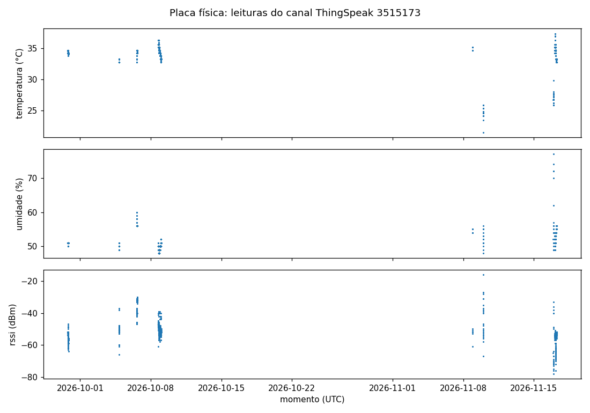
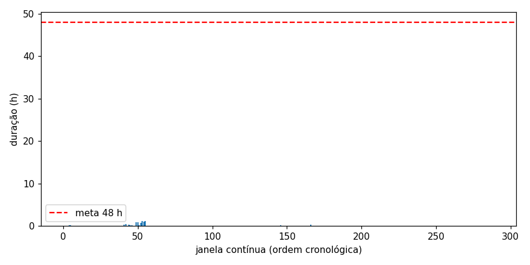

# Base da placa física: descrição e qualidade

Gerado por `descrever.py` a partir de `dados/thingspeak_3515173.csv` (canal público ThingSpeak 3515173, placa ESP32-C3 via MQTT, dado real). Requisito IOT-06.

## Cobertura

| item | valor |
|---|---|
| primeira leitura (UTC) | 2026-09-29 18:36:01 |
| última leitura (UTC) | 2026-11-17 06:16:09 |
| período entre a primeira e a última | 48.49 dias |
| leituras | 1899 |
| leituras esperadas no período (a cada 20 s) | 209461 |
| completude em relação ao esperado | 0.91% |
| dias de calendário (UTC-3) com ao menos uma leitura | 8 |
| **horas cobertas** (soma dos trechos sem lacuna) | **9.09 h** |
| **maior janela contínua** | **1.19 h** (2026-10-08 21:20 a 2026-10-08 22:32 UTC, 212 leituras) |

## Veredito sobre a meta de 48 h

**Não atendida como trecho contínuo.** A maior janela sem lacuna tem 1.19 h, abaixo das 48 h. A soma das horas cobertas é 9.09 h (também abaixo das 48 h), mas isso são trechos separados por lacunas, não 48 h seguidas. O período total (primeira a última leitura) é muito maior que a cobertura real: há semanas sem leitura entre as sessões (placa desligada ou sem rede; a causa não consta nos dados).

## Intervalo entre leituras

| métrica | valor |
|---|---|
| esperado | 20 s |
| mediana real | 20.00 s |
| p95 real | 79.00 s |

## Faltantes (lacunas)

Lacuna = intervalo entre duas leituras consecutivas maior que 2x o esperado (40 s).

| item | valor |
|---|---|
| lacunas | 289 |
| duração total das lacunas | 48.11 dias |
| fração do período em lacuna | 99.22% |
| trechos contínuos | 290 |
| leituras ausentes no período (esperadas menos presentes) | 207562 (99.09% das esperadas) |

Dez maiores lacunas:

| de (UTC) | até (UTC) | duração |
|---|---|---|
| 2026-10-09 00:49:59 | 2026-11-08 22:04:56 | 30.89 dias |
| 2026-11-09 23:15:37 | 2026-11-16 22:03:19 | 6.95 dias |
| 2026-09-29 20:06:15 | 2026-10-04 20:05:57 | 5.00 dias |
| 2026-10-06 15:46:08 | 2026-10-08 17:46:31 | 2.08 dias |
| 2026-10-04 20:29:29 | 2026-10-06 14:57:24 | 1.77 dias |
| 2026-11-08 22:12:18 | 2026-11-09 22:50:37 | 1.03 dias |
| 2026-11-16 22:34:15 | 2026-11-17 01:32:14 | 2.97 h |
| 2026-10-08 19:26:03 | 2026-10-08 19:32:05 | 0.10 h |
| 2026-09-29 19:06:53 | 2026-09-29 19:12:52 | 0.10 h |
| 2026-09-29 18:45:02 | 2026-09-29 18:50:50 | 0.10 h |

Maiores trechos contínuos:

| início (UTC) | fim (UTC) | duração | leituras |
|---|---|---|---|
| 2026-10-08 21:20:40 | 2026-10-08 22:32:19 | 1.19 h | 212 |
| 2026-10-08 23:40:05 | 2026-10-09 00:49:59 | 1.17 h | 208 |
| 2026-10-08 22:33:00 | 2026-10-08 23:39:21 | 1.11 h | 194 |
| 2026-10-08 18:30:45 | 2026-10-08 19:26:03 | 0.92 h | 165 |
| 2026-10-08 19:32:05 | 2026-10-08 20:22:59 | 0.85 h | 151 |
| 2026-10-08 20:34:40 | 2026-10-08 21:19:59 | 0.76 h | 134 |
| 2026-10-06 14:57:24 | 2026-10-06 15:24:59 | 0.46 h | 82 |
| 2026-11-17 03:10:32 | 2026-11-17 03:30:51 | 0.34 h | 62 |
| 2026-10-04 20:11:29 | 2026-10-04 20:29:29 | 0.30 h | 54 |
| 2026-10-06 15:30:01 | 2026-10-06 15:46:08 | 0.27 h | 49 |

## Inválidos

Faixa física do DHT11: temperatura 0 a 50 °C, umidade 20 a 90 %. Faixa aceita pela API (`cloud/function/contrato.py`): temperatura -40 a 80 °C, umidade 0 a 100 %. Inválido = NaN ou fora da faixa.

| variável | NaN | fora da faixa DHT11 (inclui NaN) | fora da faixa da API (inclui NaN) |
|---|---|---|---|
| temperatura | 0 | 0 (0.00%) | 0 (0.00%) |
| umidade | 0 | 0 (0.00%) | 0 (0.00%) |
| rssi | 1 | n/a | n/a |
| **leituras com ao menos uma variável inválida** | | **0 (0.00%)** | **0 (0.00%)** |

## Estatística descritiva

| variável | n | mín | Q1 | mediana | Q3 | máx | média | desvio |
|---|---|---|---|---|---|---|---|---|
| temperatura (°C) | 1899 | 21.40 | 33.80 | 34.20 | 34.70 | 37.40 | 34.17 | 1.57 |
| umidade (%) | 1899 | 48.00 | 49.00 | 50.00 | 51.00 | 77.00 | 50.86 | 2.62 |
| rssi (dBm) | 1898 | -78.00 | -54.00 | -52.00 | -49.00 | -16.00 | -50.97 | 6.30 |

