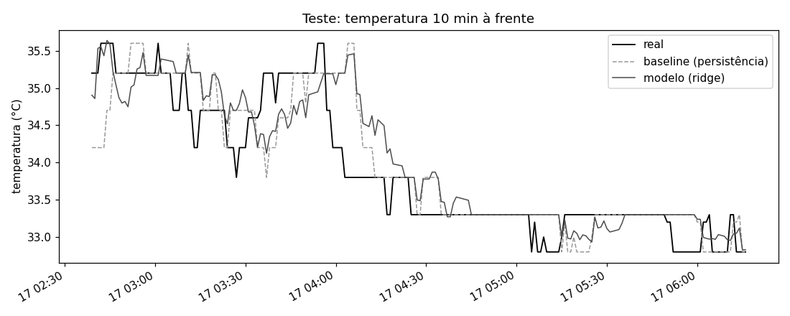

# Previsão da temperatura do sensor (10 min à frente)

Gerado por `modelo_previsao.py` em 2026-11-17 06:22 UTC, a partir de `dados/thingspeak_3515173.csv` (dado real do canal público ThingSpeak 3515173). Exporta `cloud/function/modelo_sensor.json`, lido pela rota `GET /api/predict/sensor`.

## Problema

Estimar a temperatura da carga daqui a 10 minutos a partir das últimas leituras do próprio sensor, para avisar antes de a leitura sair da faixa do perfil de carga. Apoia uma decisão humana (conferir a porta, o equipamento de frio, a rota); não dispara ação automática.

## Limpeza

| passo | removidas | restantes |
|---|---|---|
| leituras no CSV | 0 | 1899 |
| sem temperatura ou sem data | 0 | 1899 |
| fora da faixa do DHT11 (0 a 50 °C) | 0 | 1899 |
| instante repetido | 0 | 1899 |

Cadência medida: mediana 20 s entre leituras na base inteira e 78 s no trecho mais recente; 12.1 h de amostras no total. Trecho contínuo = sem intervalo maior que 300 s; 8 trechos geraram amostras (um instante por minuto, com 10 min de histórico e o alvo 10 min depois dentro do mesmo trecho). Valor entre leituras = última leitura até o instante.

## Divisão temporal

| conjunto | de (UTC) | até (UTC) | amostras |
|---|---|---|---|
| treino | 2026-09-29T19:23 | 2026-11-17T02:18 | 496 |
| teste | 2026-11-17T02:29 | 2026-11-17T06:06 | 218 |

Teste = 30% mais recentes dos instantes (corte 2026-11-17 02:29 UTC). Amostras de treino cujo alvo cai depois do corte foram descartadas.

## Resultado (teste)

| métrica | modelo (ridge) | baseline (persistência) |
|---|---|---|
| MAE (°C) | 0.342 | 0.313 |
| RMSE (°C) | 0.471 | 0.494 |

**O modelo NÃO supera o baseline** no teste: MAE 0.342 °C contra 0.313 °C da persistência. A rota continua devolvendo as duas previsões, mas recomenda a persistência (`recomendada = baseline`) até um novo treino mostrar ganho.

Coeficientes (variação prevista = soma de coeficiente × atributo, sem intercepto, lambda = 1.0):

| atributo | significado | coeficiente |
|---|---|---|
| d5 | última leitura menos a de 5 min antes | +0.1862 |
| d10 | última leitura menos a de 10 min antes | -0.3870 |
| m10 | média dos últimos 10 min menos a última leitura | +0.2164 |

## Sensibilidade ao corte (informativo, não usado para escolher nada)

| fração de teste | corte (UTC) | treino | teste | MAE modelo | MAE baseline | RMSE modelo | RMSE baseline |
|---|---|---|---|---|---|---|---|
| 20% | 2026-11-17 03:42 | 569 | 145 | 0.339 | 0.262 | 0.491 | 0.448 |
| 30% | 2026-11-17 02:29 | 496 | 218 | 0.342 | 0.313 | 0.471 | 0.494 |
| 40% | 2026-10-09 00:30 | 424 | 290 | 0.476 | 0.477 | 0.680 | 0.751 |

## Limitações

- Poucos dados: as amostras somam poucas horas, em trechos curtos separados por lacunas longas.
- Sensor em bancada, em ambiente interno, não dentro de um baú refrigerado: não há nenhuma excursão térmica real (porta aberta, falha do frio) na base. A série é quase estável e varia em degraus de resolução do DHT11, cenário em que a persistência é difícil de bater.
- O modelo não sabe nada de clima, rota ou porta: só extrapola a própria série.

## Re-treinar

```bash
cd analise/sensor
python modelo_previsao.py --baixar   # baixa o canal de novo, treina, avalia e exporta
```


