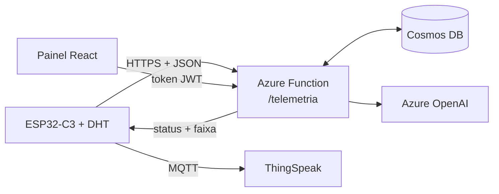

# Apresentação — ColdTrack

Roteiro da apresentação do Projeto Integrador (4º período, TADS, Faculdade Senac PE, 2026.2).
Cada bloco separado por linha horizontal é um slide. Versão em PowerPoint:
[`apresentacao.pptx`](apresentacao.pptx). Notas de fala no final:
[Notas para apresentar](#notas-para-apresentar). Mapa completo do que o sistema faz:
[`funcionalidades.md`](funcionalidades.md).

---

## 1. ColdTrack: monitoramento da cadeia fria

- Monitoramento IoT do transporte refrigerado de frutas do Vale do São Francisco
- Nó sensor ESP32-C3 no baú, API no Azure e painel web por empresa
- Projeto Integrador, 4º período de TADS, Faculdade Senac PE, 2026.2
- Painel: stcoldtrackweb7319.z15.web.core.windows.net
- Professor orientador: Arnot Caiado

---

## 2. Problema

- Manga e uva saem de Petrolina e Juazeiro em caminhões refrigerados rumo aos portos
- A fruta perde qualidade quando a temperatura do baú sai da faixa, por calor ou por frio demais
- A rota Petrolina–Suape passa por trechos de calor intenso e de sinal de celular fraco
- Sem registro contínuo, a transportadora só descobre o problema na chegada
- Falta rastreabilidade: quando, por quanto tempo e quão longe da faixa a carga ficou

---

## 3. Solução

- Sensor no baú mede temperatura e umidade a cada 20 segundos
- A própria placa classifica a leitura (normal, atenção, crítico) e sinaliza na hora
- A leitura vai para a nuvem por HTTPS; sem sinal, fica guardada e é reenviada depois
- Painel web mostra situação de cada veículo, alertas, viagens e relatórios
- Faixa de temperatura definida pelo tipo de carga (manga, uva)
- Várias transportadoras na mesma plataforma, cada uma vendo só os próprios dados

---

## 4. Arquitetura

- Borda: ESP32-C3 com sensor DHT, LEDs ou tela OLED e fila offline
- Nuvem: Azure Function (Python) com Cosmos DB e Azure OpenAI
- Apresentação: painel React + Vite em site estático no Azure Storage
- Cópia das leituras por MQTT no ThingSpeak, para monitoramento público

---

## 5. Hardware

- Microcontrolador ESP32-C3 com Wi-Fi 2.4 GHz
- Sensor DHT11 na placa física e DHT22 na simulação do Wokwi
- LEDs verde, amarelo e vermelho; ou tela OLED 0,42" na placa com tela embutida
- Alimentação USB-C; gabinete previsto em material reaproveitado (design circular)
- Limitações: DHT11 não mede abaixo de 0 °C e Wi-Fi depende de rede no veículo

---

## 6. Firmware

- Leitor próprio do DHT, com checksum e sem travar a placa quando o sensor falha
- Classificação na borda com a faixa recebida da nuvem e salva na flash
- Envio HTTPS com chave própria do sensor e certificado do servidor verificado
- Fila offline na flash: até 500 leituras (cerca de 2 h 45 min), reenviadas em ordem
- Horário real de cada medição (NTP); reenvio não duplica dados
- Configuração de Wi-Fi, ID e chave pelo cabo USB, direto do painel

---

## 7. Nuvem e API

- API em Python 3.11 na Azure Function, plano de consumo, região Brazil South
- Cosmos DB com sete containers: empresas, usuários, sensores, veículos, viagens, leituras e limites
- Rota do sensor: POST /telemetria valida, classifica, grava e devolve a faixa
- Rotas do painel: login, cadastros, leituras, sensores, veículos, viagens e usuários
- Documentação interativa (Swagger): https://func-coldtrack-7319.azurewebsites.net/api/docs
- Perfis de carga: manga normal de 10 a 13 °C, uva de -1 a 0 °C, margem de atenção
- Perfis de usuário: gestor cadastra, operador consulta

---

## 8. Painel web

- Dashboard: leitura atual, gráfico de 30 min com a faixa e calor previsto na rota
- Veículos: situação de cada carga, aviso de sem sinal e etiqueta QR para o baú
- Sensores: situação ao vivo e conexão do sensor pelo cabo USB (Web Serial)
- Viagens: condição da carga do início ao fim de cada trajeto
- Alertas e Relatórios: ocorrências fora da faixa, resumo por período e CSV
- Configurações: senha, faixas e gestão de usuários; funciona no celular (PWA)

---

## 9. Inteligência artificial

- Chat público na página inicial: responde sobre o projeto a partir da documentação (RAG)
- Assistente do painel: responde sobre uso das telas e dados da própria empresa
- Azure OpenAI: gpt-4.1-mini para responder e text-embedding-3-small para a busca
- Somente leitura: o assistente explica o caminho nas telas, não executa ações
- Limites por minuto e por dia; se o chat falhar, o site responde pelo FAQ
- Links externos removidos e textos de usuários tratados como dado não confiável

---

## 10. Segurança

- Chave própria por sensor; o banco guarda só o hash
- Senha com scrypt e sal; token JWT de 8 h, derrubado ao sair ou trocar a senha
- Espera crescente após 5 senhas erradas e limite de tentativas por IP
- Cada empresa só acessa os próprios dados, conferido pela API em toda chamada
- Só HTTPS, CORS restrito ao painel, publicação por OIDC sem senha no repositório
- Limitações conhecidas documentadas em docs/seguranca.md

---

## 11. Testes e qualidade

- API: 165 testes automatizados passando, mais lint
- Firmware compilado no CI nas variantes DHT11 e DHT22
- Simulação no Wokwi: queda de conexão, excursão térmica e faixa da manga
- Painel: 158 testes unitários e 206 testes e2e com a API simulada
- 57 testes e2e contra o site e a API em produção, todos passando
- GitHub Actions roda tudo a cada push; publicação só com os testes verdes

---

## 12. Monitoramento ThingSpeak

- A placa publica por MQTT/TLS no canal público 3515173 do ThingSpeak
- field1 temperatura (°C), field2 umidade (%), field3 RSSI (dBm), a cada 20 s
- Canal registrado na plataforma de monitoramento da turma (iotdashthings)
- MQTT independente do HTTPS: falha em um não derruba o outro
- Comparação medida na placa: tempo e bytes de cada envio HTTPS e MQTT

---

## 13. Demonstração

1. Abrir o site e fazer uma pergunta ao chat da página inicial
2. Entrar com a conta de demonstração (gestor) e mostrar o Dashboard e o calor na rota
3. Veículos: situação da carga e etiqueta QR do veículo
4. Sensores: sensor ONLINE e o fluxo de conexão pelo cabo USB
5. Alertas e Relatórios: ocorrências fora da faixa e baixar o CSV
6. Assistente do painel: perguntar quantos veículos e sensores a empresa tem
7. ThingSpeak: abrir o canal 3515173 e ver as leituras chegando

---

## 14. Resultados e próximos passos

- Fluxo completo funcionando: placa física, nuvem, painel e IA publicados
- Placa enviando ao Azure e ao ThingSpeak ao mesmo tempo
- Próximo: montagem física no gabinete reciclado e testes de campo no baú
- Próximo: configuração pelo celular (Bluetooth) e várias redes Wi-Fi salvas
- Próximo: faixas validadas com o produtor e confirmação de e-mail no cadastro
- Próximo: comunicação celular ou LoRaWAN para a estrada

---

## 15. Equipe

- Enzo Antônio
- Everson
- Emmanuel Luís
- Gabriel Eduardo
- José Allamberg
- Marcelo Barbosa

---

## Notas para apresentar

1. **ColdTrack.** Apresentar o nome, o tema (cadeia fria) e mostrar que tudo está publicado e funcionando.
2. **Problema.** Contextualizar a fruticultura do Vale e o risco de perder carga por temperatura fora da faixa durante a viagem.
3. **Solução.** Resumir a ideia: medir no baú, classificar na hora, guardar sem sinal e mostrar tudo num painel.
4. **Arquitetura.** Seguir o caminho de uma leitura: sensor, HTTPS, Function, Cosmos DB, painel; citar MQTT e Azure OpenAI como ramos.
5. **Hardware.** Mostrar a placa; explicar por que DHT11 na placa e DHT22 no simulador, e a limitação abaixo de 0 °C.
6. **Firmware.** Destacar a fila offline (rota sem sinal não deixa buraco) e a configuração pelo cabo sem regravar o código.
7. **Nuvem e API.** Explicar que a API é a fonte da regra de faixas e que cada empresa é isolada pelo token.
8. **Painel web.** Passar rapidamente pelas telas; a demonstração mostra as principais ao vivo.
9. **Inteligência artificial.** Diferenciar o chat público (documentação) do assistente logado (dados da empresa) e citar os limites.
10. **Segurança.** Citar os três pilares: chave por sensor, login protegido e separação entre empresas.
11. **Testes e qualidade.** Mostrar os números e que a publicação só acontece com os testes passando.
12. **Monitoramento ThingSpeak.** Mostrar o canal e explicar a integração com a plataforma da turma.
13. **Demonstração.** Seguir os passos na ordem; ter o canal do ThingSpeak e o painel abertos em abas antes de começar.
14. **Resultados e próximos passos.** Reforçar o que já funciona de ponta a ponta e o que falta para o uso em campo.
15. **Equipe.** Apresentar os integrantes e abrir para perguntas.
