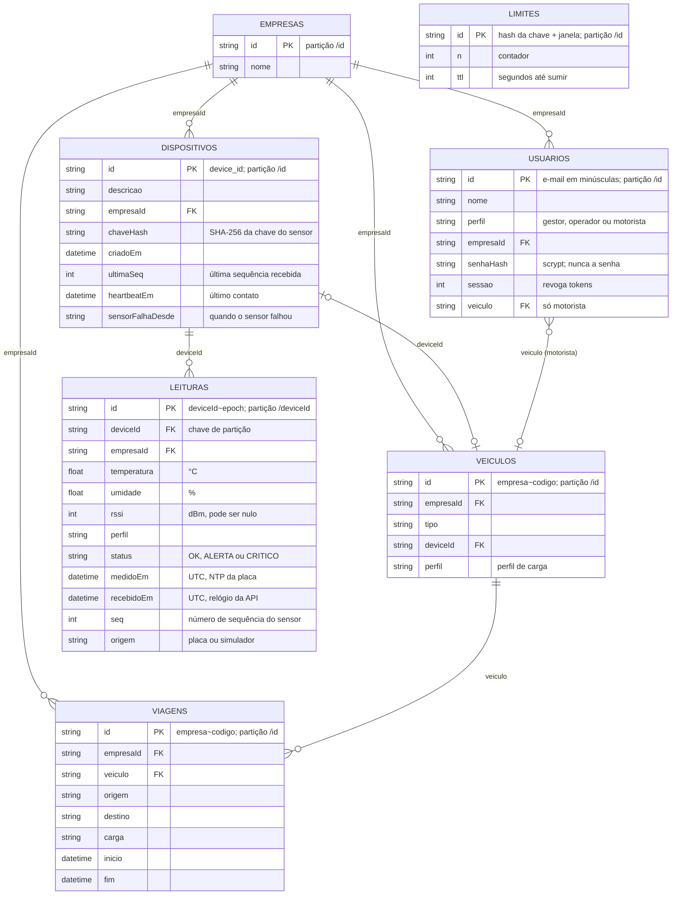

# Banco de dados do ColdTrack

O banco é o **Azure Cosmos DB for NoSQL** (conta `cosmos-coldtrack-7319`, banco `coldtrack`, free
tier). Não é relacional: não há tabelas, `JOIN` nem chave estrangeira imposta pelo banco. Os dados
são documentos JSON agrupados em containers, e a integridade que um SGBD relacional faria sozinho
é feita aqui pela **chave de partição + `id` único** e pelo código da API (tabela da seção 4). O
diagrama abaixo mostra as entidades e os vínculos lógicos (a API é quem os respeita).

## 1. Diagrama entidade-relacionamento



`LIMITES` não se liga a nada: guarda só os contadores do limite de requisições (a chave é um hash
de IP ou e-mail, nunca o valor em texto).

## 2. Containers, partições e TTL

| container | chave de partição | `id` | TTL | observação |
|---|---|---|---|---|
| `empresas` | `/id` | código da empresa | não | |
| `usuarios` | `/id` | e-mail em minúsculas | não | o `id` único impede e-mail repetido (409) |
| `dispositivos` | `/id` | `deviceId` | não | guarda só o hash da chave do sensor |
| `veiculos` | `/id` | `empresa~codigo` | não | prefixo da empresa evita colisão entre empresas |
| `viagens` | `/id` | `empresa~codigo` | não | |
| `leituras` | `/deviceId` | `deviceId~epoch` | não | maior volume: 1 leitura a cada 20 s por sensor |
| `limites` | `/id` | hash + janela | **sim** (2 dias, e cada contador leva o próprio `ttl`) | índice desligado: só leitura por `id` |

A chave de partição não muda depois de criada. Em `leituras` ela é o `deviceId`: toda consulta da
API é de um sensor só, então cai em uma única partição (consulta barata) e a carga se espalha
entre os sensores.

## 3. Requisitos do professor e como o Cosmos os atende

### Índice por dispositivo e tempo

O Cosmos indexa **todas as propriedades** por padrão (`indexingMode: consistent`, sem exclusões, em
`infra/main.bicep`), então não há `CREATE INDEX`. Para as leituras:

- `deviceId` é a chave de partição: `WHERE c.deviceId = @d` vai direto à partição do sensor.
- `medidoEm` tem índice de intervalo: `ORDER BY c.medidoEm DESC` (última leitura, janela de uma hora,
  histórico) e filtros de data usam o índice, sem varrer o container. Exemplo real da API:
  `SELECT TOP 1 c.recebidoEm FROM c WHERE c.deviceId = @d ORDER BY c.medidoEm DESC`
  (`ultima_leitura_recebida`, em `cloud/function/function_app.py`).
- Só `limites` desliga a indexação, de propósito (lê só por `id`).

### Restrições de integridade

| regra | como é garantida |
|---|---|
| Leitura não duplica (idempotência) | `id = deviceId~epoch` (R3) e `create_item`, nunca `upsert`. O mesmo `id` na mesma partição devolve conflito do próprio Cosmos; a API compara os valores e responde `200 {duplicada: true}` se for reenvio idêntico (o sensor tira da fila) ou `409` se os valores forem outros |
| Sequência sem lacuna | `seq` vem do firmware e é guardada na leitura e em `dispositivos.ultimaSeq`; `GET /api/leituras` aponta lacunas calculadas pelo `seq` |
| E-mail e `device_id` únicos | são o próprio `id` do documento; criar repetido dá `CosmosResourceExistsError` e a API responde 409 |
| Cada empresa só vê o que é seu | toda consulta filtra por `empresaId` vindo do token (nunca do corpo); item de outra empresa responde 404 |
| Dado obrigatório e faixa válida | validado antes de gravar (`contrato.py`, `cadastros.py`): leitura malformada ou fora de faixa responde 400 e nada é gravado |
| Segredo nunca em texto | `usuarios.senhaHash` (scrypt) e `dispositivos.chaveHash` (SHA-256) |
| Dado simulado identificado | campo `origem` em cada leitura (`placa` ou `simulador`) |

O Cosmos não tem chave estrangeira: `empresaId`, `deviceId` e `veiculo` são referências lógicas e a
API confere a existência antes de gravar (por exemplo, `veiculo` do motorista precisa existir na
mesma empresa).

## 4. Script de criação

Dois caminhos, o mesmo resultado (os sete containers da seção 2, com as mesmas chaves):

| onde | arquivo | uso |
|---|---|---|
| Azure (produção) | [`infra/main.bicep`](../../infra/main.bicep) | cria a conta, o banco, os containers, o TTL e a política de índice; passo a passo em [`infra/README.md`](../../infra/README.md) |
| Emulador (local e CI) | [`infra/ci/preparar_banco.py`](../../infra/ci/preparar_banco.py) | `python infra/ci/preparar_banco.py http://localhost:8081` cria o banco, os containers e um gestor de teste |

## 5. Dados de exemplo

[`infra/ci/dados_exemplo.py`](../../infra/ci/dados_exemplo.py) carrega um conjunto **sintético**:
1 empresa (`emp-exemplo`), 1 sensor, 1 veículo, 1 viagem e 12 leituras (9 a 20 °C, `seq` de 1 a 12,
uma a cada 20 s), todos com `origem: "simulador"`. Nada é dado real.

```bash
docker compose -f infra/docker-compose.yml up -d cosmos
pip install azure-cosmos==4.17.1 PyJWT==2.15.1
python infra/ci/preparar_banco.py http://localhost:8081   # banco e containers
python infra/ci/dados_exemplo.py  http://localhost:8081   # dados de exemplo
```

O script roda a carga duas vezes e confere que cada documento existe uma vez só (prova de que o
`id` determinístico impede duplicata). O workflow **Compose e ZAP** executa esse passo a cada pull
request que mexa em `infra/` ou na API.

## 6. Backup

Backup lógico (exportação e restauração em JSONL) em [`infra/backup/`](../../infra/backup/);
procedimento e limites em [`infra/README.md`](../../infra/README.md) e em `RESILIENCIA.md` (R8).
