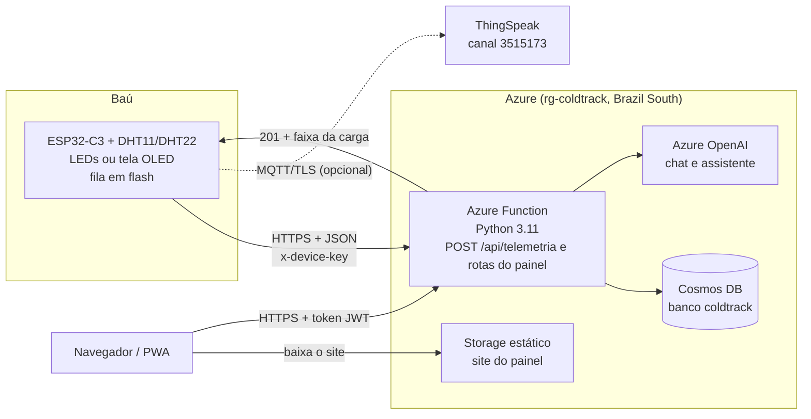
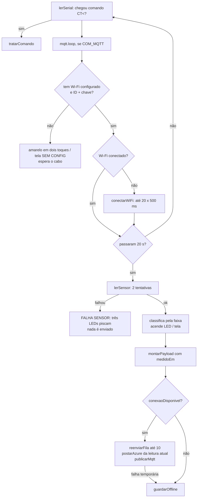
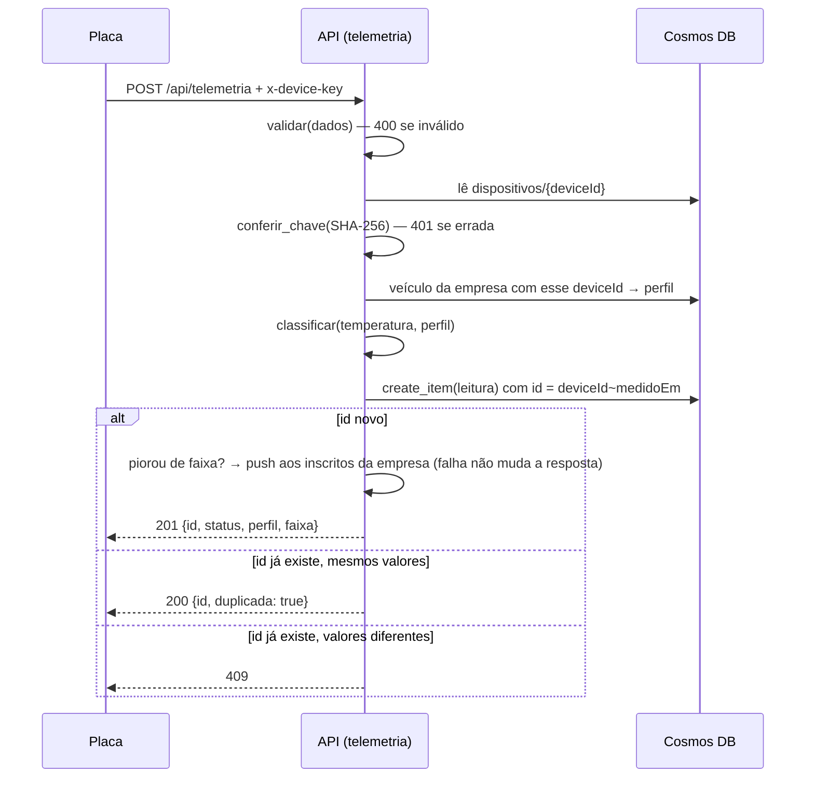
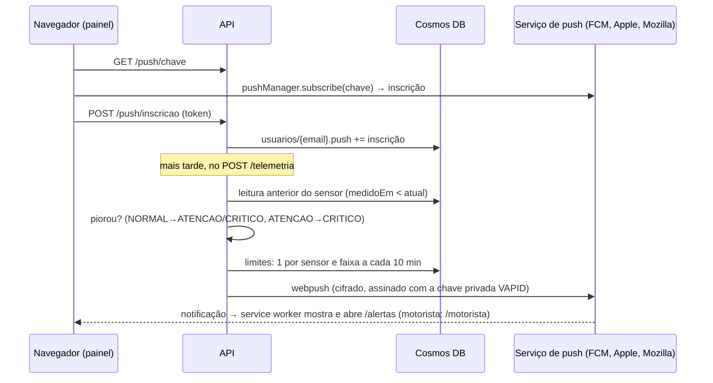

# Como o ColdTrack funciona: guia único de estudo

Documento para estudar o sistema inteiro antes da arguição individual. Cada seção explica uma
camada do jeito que ela pode ser contada em voz alta, e cada afirmação técnica aponta para o
arquivo e a função onde está no código. O que ainda não existe aparece como "não implementado",
com o que está no plano.

Estado: 16/11/2026, `main` dos dois repositórios
([projeto-integrador-4-periodo](https://github.com/mbalbuquerque/projeto-integrador-4-periodo),
chamado aqui de **back**, e [Front-End-pi](https://github.com/mbalbuquerque/Front-End-pi),
chamado de **front**). Caminhos sem prefixo são do back; os do front vêm marcados com `front:`.

Sumário:

1. [Visão em 1 minuto](#1-visão-em-1-minuto)
2. [Estrutura dos repositórios](#2-estrutura-dos-repositórios)
3. [Firmware passo a passo](#3-firmware-passo-a-passo)
4. [API](#4-api)
5. [Banco de dados](#5-banco-de-dados)
6. [Painel e PWA](#6-painel-e-pwa)
7. [Nuvem e publicação](#7-nuvem-e-publicação)
8. [Resiliência](#8-resiliência)
9. [Segurança](#9-segurança)
10. [Qualidade](#10-qualidade)
11. [Inteligência artificial](#11-inteligência-artificial)
12. [Pesquisa, persona e mobile](#12-pesquisa-persona-e-mobile)
13. [Respostas para o banco de perguntas](#13-respostas-para-o-banco-de-perguntas)
14. [Glossário](#14-glossário)

---

## 1. Visão em 1 minuto

**Problema.** Manga e uva do Vale do São Francisco viajam em baú refrigerado de Petrolina até o
porto de Suape. Se a temperatura sai da faixa no caminho, o dano (por exemplo, o corte negro da
manga) só aparece no destino, e sem registro ninguém prova o que aconteceu na viagem
(`docs/ux/pesquisa-secundaria.md`).

**Solução.** Um sensor no baú mede temperatura e umidade a cada 20 s, classifica a leitura pela
faixa da carga (normal, atenção, crítico), acende o sinal na própria placa e envia a leitura para
uma API na nuvem. Um painel web mostra a situação de cada veículo, os alertas, as viagens e os
relatórios, separando os dados de cada transportadora.

**Arquitetura.**



Dois caminhos saem da placa: o **principal** é HTTPS para a API própria, que confirma cada
gravação e devolve a faixa da carga; o **secundário** é MQTT para o ThingSpeak, usado na
plataforma de monitoramento da turma e na tela demonstrativa Monitoramento. O painel **só lê a
API**, nunca o ThingSpeak (`README.md`, seção Arquitetura).

**Quem usa.**

| quem | o que faz | onde |
|---|---|---|
| Gestor da transportadora | Cadastra empresa, usuários, sensores, veículos e viagens; acompanha tudo | Painel, perfil `gestor` |
| Operador logístico | Acompanha a carga, alertas e relatórios; não altera cadastros | Painel, perfil `operador` |
| Motorista | Vê o semáforo (LED) no sensor e, no celular, a temperatura do próprio veículo (somente leitura) | Placa; painel, perfil `motorista` |
| Sensor | Envia leituras com a chave própria | `POST /api/telemetria` |

---

## 2. Estrutura dos repositórios

### Back (`projeto-integrador-4-periodo`)

| pasta / arquivo | o que tem |
|---|---|
| `firmware/coldtrack/coldtrack.ino` | Firmware do ESP32-C3 (Arduino): leitura do DHT, classificação, LEDs/tela, HTTPS, MQTT, fila offline, configuração pelo cabo |
| `firmware/coldtrack/payload_core.h` | Cópia testável de três funções do firmware (montar o JSON, ler número do JSON, classificar). O `.ino` ainda não inclui esse arquivo |
| `firmware/coldtrack/azure_ca.h` | Certificado raiz (DigiCert Global Root G2) usado para validar o TLS |
| `firmware/coldtrack/secrets.example.h` | Modelo do `secrets.h` (o real nunca vai para o Git) |
| `firmware/tests/test_firmware.cpp` | 4 testes C++ do `payload_core.h`, rodados no CI com `g++` |
| `firmware/wokwi/` | Circuito da simulação (`diagram.json`, `libraries.txt`) |
| `cloud/function/function_app.py` | Todas as rotas da API |
| `cloud/function/contrato.py` | Contrato da telemetria, perfis de carga, classificação, idempotência |
| `cloud/function/seguranca.py` | Senha (scrypt), token JWT, espera do login, chave do sensor |
| `cloud/function/limites.py` | Limites de uso, contados no Cosmos |
| `cloud/function/cadastros.py` | Validação de empresa, usuário, sensor, veículo e viagem |
| `cloud/function/chat.py`, `assistente.py`, `base_chat.json` | Chat do site e assistente do painel (Azure OpenAI + busca por embeddings) |
| `cloud/function/predicao.py`, `modelo_risco.json` | Modelo de risco térmico servido em `GET /api/predict` |
| `cloud/function/openapi.json` | Especificação OpenAPI 3.0, em inglês, exibida em `/api/docs` |
| `cloud/function/test_*.py` | Testes da API (pytest/unittest, com Cosmos falso) |
| `cloud/function/pacote.txt`, `publicar.sh` | Lista do que é publicado e publicação manual |
| `cloud/function/scripts/` | Criar usuário, gerar a base do chat, migração para multiempresa |
| `infra/` | `main.bicep` (o ambiente Azure descrito em código), `Dockerfile`, `docker-compose.yml`, `README.md` com custos e OIDC |
| `analise/` | Análise climática do INMET e o modelo de risco; `analise/sensor/` descreve a base real da placa |
| `docs/` | Documentação (API, segurança, STRIDE, LGPD, QA, UX, model card, implantação, slides) |
| `.github/workflows/` | `testes.yml` (CI), `publicar-api.yml` (deploy), `seguranca.yml` (pip-audit e ZAP) |
| `RESILIENCIA.md`, `REQUISITOS_UC.md`, `PLANO_ACAO.md` | Requisitos R1–R8/F1–F6, matriz por disciplina e plano de ação |

### Front (`Front-End-pi`)

| pasta / arquivo | o que tem |
|---|---|
| `front: src/main.jsx`, `src/App.jsx`, `src/rotas.js` | Entrada do React, rotas (cada tela com `lazy`), menu e URLs antigas |
| `front: src/pages/<Tela>/` | Uma pasta por tela, com as regras puras em `.js` e testes ao lado |
| `front: src/lib/` | Lógica sem React: `api.js`, `sessao.js`, `leituras.js`, `faixas.js`, `predicao.js`, `chat.js`, `assistente.js`, `armazenamento.js` |
| `front: src/hooks/` | `useSessao`, `usePolling`, `useVeiculoEscolhido`, `useTitulo`, `useMovimentoReduzido` |
| `front: src/components/` | `PainelLayout`, `RequireAuth`, `Estado`, `StatusSelo`, gráfico, chat e assistente |
| `front: public/sw.js`, `public/manifest.json` | Service worker e manifesto do PWA |
| `front: vite.config.js` | Build, escopo de CSS por família, cópias `.html` antigas e CSP |
| `front: coldtrack-qa/` | Testes e2e (Playwright): simulados (`tests/`) e contra produção (`real/`) |
| `front: docs/` | `ARQUITETURA.md`, `guia-de-uso.md`, `relatorio-de-testes.md` |
| `front: .github/workflows/` | `testes.yml`, `publicar-site.yml`, `seguranca.yml` (npm audit) |

---

## 3. Firmware passo a passo

Arquivo: `firmware/coldtrack/coldtrack.ino` (versão `FW_VERSAO "2026.11.17.1"`).

### 3.1 Hardware e variantes

- Sensor DHT no GPIO 4 (`DHT_PIN`). Padrão DHT22 (simulação Wokwi); a placa física usa DHT11
  (`#define DHT_TYPE DHT11` no `secrets.h`).
- **Sem tela** (Wokwi): três LEDs nos GPIO 5, 6 e 7 (`LED_VERDE`, `LED_AMARELO`, `LED_VERMELHO`).
- **Com tela** (`TELA_OLED`, placa ESP32-C3 com OLED 0,42" embutido): os GPIO 5 e 6 viram o I2C
  da tela (72x40 pixels, `U8G2_SSD1306_72X40_ER_F_HW_I2C`), os LEDs saem e o status vai para a tela
  (`desenharTela`, seção 3.12). LED da própria placa só com `LED_PLACA` no `secrets.h` (3.12). Nessa placa a potência do rádio cai para 8,5 dBm (`ajustarRadio`), porque a
  antena de chip falhava no handshake com a potência padrão.
- MQTT só é compilado se o `secrets.h` tiver `MQTT_CANAL`, `MQTT_CLIENT_ID`, `MQTT_USUARIO` e
  `MQTT_SENHA` (macro `COM_MQTT`).

### 3.2 `setup()`: o que acontece ao ligar

1. Abre a serial a 115200 baud com buffer de recepção de 1024 bytes (o comando de configuração
   passa de 200 bytes).
2. Prepara os LEDs ou a tela ("INICIANDO").
3. Monta o LittleFS (`LittleFS.begin(true)`: formata a flash se ainda não houver sistema de
   arquivos) e conta a fila pendente (`contarFila`).
4. Se a fila tiver linhas sem horário de antes deste boot, descarta essas linhas
   (`reescreverFilaMs(false)`): o `millis()` zerou e elas perderam a referência de tempo.
5. Lê a faixa da carga guardada (`carregarFaixa`, namespace `coldtrack` do `Preferences`) e a
   configuração (`carregarConfig`, namespace `config`: `ssid`, `senha`, `id`, `chave`). O que está
   gravado na flash vale mais que o `secrets.h`; o `secrets.h` só é usado se a flash estiver vazia
   (é o caso do Wokwi).
6. Liga o Wi-Fi em modo estação e registra o evento de queda (`aoCairWiFi` guarda o motivo).
7. Conecta ao Wi-Fi (`conectarWiFi`) e pede a hora por NTP (`sincronizarRelogio`).

### 3.3 `loop()`: um ciclo



### 3.4 Leitura do DHT (validação, checksum, 2 tentativas)

O firmware tem um **leitor próprio** em vez da biblioteca DHT. Motivo, escrito no código: a
biblioteca desliga as interrupções durante a leitura e, com o sensor mudo (mau contato), o
watchdog do sistema reiniciava a placa em loop.

- `lerDhtUmaVez`: põe o pino em dreno aberto (só puxa para baixo; o resistor do módulo faz o
  nível alto), manda o pulso de início (20 ms no DHT11, ~1,1 ms no DHT22), espera a resposta e lê
  40 bits medindo a duração de cada pulso com limite de tempo (`esperarNivel`; pulso alto acima de
  45 µs é bit 1).
- `decodificarDht`: confere o **checksum** (soma dos 4 primeiros bytes igual ao 5º) e converte
  conforme o tipo (DHT11 ou DHT22, com sinal negativo).
- `lerSensor`: faz **duas tentativas** (a segunda depois de 1,1 s no DHT11 ou 2,1 s no DHT22),
  porque uma interrupção do Wi-Fi pode esticar um pulso e errar o checksum. Sem leitura válida,
  devolve `false` e `NAN` nos dois valores.
- No `loop()`, `NAN` gera "ERRO: Falha na leitura do sensor!", mostra "FALHA SENSOR" na tela (com
  `--.-°C`), faz os três LEDs piscarem juntos (seção 3.12) e **retorna sem enviar e sem guardar na
  fila**. Leitura inválida
  nunca sai como válida. Mesmo que saísse, a API recusaria `NaN` e valores fora da faixa física
  (`contrato.validar`).
- Autoteste da conversão: compilado com `-DTESTE_DHT`, `autotesteDht` confere 5 casos conhecidos
  (inclusive checksum errado).

### 3.5 Classificação normal, atenção e crítico

Regra (igual no firmware, na API em `contrato.classificar` e no painel em
`front: src/pages/Dashboard/telemetria.js`, `classificarTemperatura`):

- **NORMAL**: dentro de `[min, max]`;
- **ATENÇÃO**: até `margem` graus fora da faixa, para cima ou para baixo;
- **CRÍTICO**: além disso. Frio demais também conta.

| perfil (`contrato.PERFIS_CARGA`) | normal | atenção | crítico |
|---|---|---|---|
| demonstrativo (padrão) | até 15 °C | até 20 °C | acima de 20 °C |
| manga | 10 a 13 °C | 7 a 10 ou 13 a 16 °C | abaixo de 7 ou acima de 16 °C |
| uva | -1 a 0 °C | -3 a -1 ou 0 a 2 °C | abaixo de -3 ou acima de 2 °C |

A placa começa no perfil demonstrativo (`faixaMin = NAN`, `faixaMax = 15`, `faixaMargem = 5`).
A cada `201` da API, `atualizarFaixa` lê o campo `faixa` da resposta e, **só se mudou**, grava na
flash (poupa escrita). Sem sinal, a placa continua classificando pela última faixa recebida.

Sinalização: `statusNormal` (verde), `statusAtencao` (amarelo), `statusCritico` (vermelho), ou o
texto na tela OLED; o piscar do LED da faixa conta a situação da conexão (seção 3.12). Isso é a "classificação na borda": o motorista vê o semáforo mesmo sem
internet.

### 3.6 Envio HTTPS com `x-device-key` e TLS

`postarAzure(payload)`:

1. Cria um cliente TLS e fixa o certificado raiz com `setCACert(AZURE_ROOT_CA)` (de `azure_ca.h`:
   DigiCert Global Root G2, que assina `*.azurewebsites.net`, válido até 2038). Sem isso a placa
   aceitaria qualquer servidor.
2. `POST` em `AZURE_FUNCTION_URL` (padrão
   `https://func-coldtrack-7319.azurewebsites.net/api/telemetria`), com `Content-Type:
   application/json` e o cabeçalho **`x-device-key`** com a chave do sensor. Tempo limite de 5 s
   (`HTTP_TIMEOUT_MS`).
3. Corpo, montado por `montarPayload`:
   `{"deviceId":"coldtrack-01","temperatura":12.4,"umidade":81.0,"rssi":-58,"medidoEm":1790000000}`.
   RSSI maior ou igual a zero (valor impossível, aparece no simulador) vai como `null`. Sem relógio
   sincronizado, o `medidoEm` é omitido.
4. Resposta `201`: gravado; atualiza a faixa. `200`: a leitura já estava gravada (reenvio).
   Outro código: registra o erro.
5. Cada envio imprime uma linha `MEDIDA;https;<ms>;<bytes enviados>;<bytes recebidos>;<ok>`
   (`ClienteContado` conta os bytes de aplicação), usada para comparar HTTPS e MQTT.

`falhaTemporaria(status)`: só é falha temporária `status <= 0` (rede) ou `>= 500` (servidor).
Um `4xx` (dado recusado pelo contrato) não melhora reenviando.

### 3.7 MQTT para o ThingSpeak

Bloco `#ifdef COM_MQTT`:

- Conexão persistente em `mqtt3.thingspeak.com:8883` com TLS (mesma raiz DigiCert), keep-alive de
  120 s e tempo limite de 5 s.
- `garantirMqtt`: só tenta com rede e com relógio válido (o certificado não se valida sem hora). Se
  falhar, espera **5 s, dobrando até 60 s** (`mqttEspera`) antes da próxima tentativa, e imprime o
  motivo traduzido (`estadoMqtt`).
- `publicarMqtt`: publica `field1=<temp>&field2=<umid>&field3=<rssi>` no tópico
  `channels/<canal>/publish`, com **QoS 0** (o ThingSpeak não aceita 1 ou 2): o broker não
  confirma a entrega.
- Leitura feita sem rede **não vai para o MQTT**; a fila offline é só do HTTPS (o plano gratuito
  do ThingSpeak aceita uma mensagem a cada 15 s).
- Os dois caminhos são independentes: falha do MQTT não muda o fluxo do HTTPS.

### 3.8 Fila em flash (store-and-forward)

Constantes: arquivo `/fila.jsonl` (uma leitura JSON por linha), `FILA_MAX 500` (~2 h 45 min a cada
20 s), `REENVIO_POR_CICLO 10`.

- `guardarOffline`: sem conexão, ou com falha temporária no envio, a leitura vai para a fila
  (`enfileirar`). Se a fila passar de 500, **descarta a mais antiga** (`descartarInicioDaFila`).
  Se a flash não abrir, a leitura é perdida e isso sai no log.
- Sem relógio, a linha é guardada com `"ms"` (o `millis()` da medição) no lugar do `medidoEm`.
  Quando o relógio sincroniza, `reescreverFilaMs(true)` converte para o horário real
  (`agora - (millis atual - ms) / 1000`). Linhas com `"ms"` de antes de um reinício são descartadas
  no boot.
- `reenviarFila`: com conexão, **antes** da leitura atual, envia até 10 leituras da fila, **da
  mais antiga para a mais nova**, para manter a ordem. Para na primeira falha temporária. As que
  receberam resposta definitiva (201, 200 e também 4xx) saem da fila.
- O horário da medição (`medidoEm`) viaja junto: o banco guarda quando foi medido, não quando
  chegou.

### 3.9 Horário (NTP)

`sincronizarRelogio` chama `configTime(0, 0, "pool.ntp.org", "time.google.com")` (UTC).
`relogioOk` só considera o relógio válido depois de `EPOCH_VALIDO` (1700000000, nov/2023).
Para testes há `SIMULAR_SEM_RELOGIO_S` e `SIMULAR_QUEDA_S`, que fingem relógio e rede fora nos
primeiros N segundos (`SIMULAR_QUEDA_INICIO_S` adia o começo da queda, para simular a rede caindo
com a placa já enviando), e `SIMULAR_API_STATUS`, que faz o envio devolver esse status HTTP sem
sair da placa (prova de tela e LED no simulador sem escrever na API de produção).

### 3.10 Reconexão

- **Wi-Fi**: a cada passada do `loop()`, se `WiFi.status() != WL_CONNECTED`, chama
  `conectarWiFi`, que tenta por até 20 x 500 ms (cerca de 10 s) e devolve o controle. Não há
  espera crescente no Wi-Fi: a próxima tentativa é na próxima passada. A medição a cada 20 s
  continua acontecendo, e as leituras vão para a fila.
- **MQTT**: espera crescente de 5 s até 60 s (seção 3.7).
- **Watchdog**: o firmware **não configura** watchdog de tarefa (R4 pendente).

### 3.11 Configuração pelo cabo (Web Serial) e gravação da placa

Duas coisas diferentes:

**a) Gravar o firmware** (uma vez por placa, ou ao atualizar). É feito com o arduino-cli ou a
Arduino IDE, não pelo site. Placa física: `--fqbn esp32:esp32:esp32c3:CDCOnBoot=cdc` (o "USB CDC
On Boot" ligado é o que faz a serial USB funcionar), DHT11 e `TELA_OLED` no `secrets.h`, sem
Wi-Fi nem chave (comandos em `README.md`, seção Firmware). O procedimento que a equipe usa na
placa física, com um script de apoio mantido fora do repositório, é: (1) gravar 20 s da serial do
firmware que está na placa; (2) copiar a flash inteira com `esptool read-flash` (dá para voltar
com `write-flash`); (3) compilar com DHT11, tela OLED e, se houver, as credenciais do MQTT; (4)
gravar com `arduino-cli upload`. Depois disso a placa mostra "SEM CONFIG / LIGUE O CABO" na tela
esperando configuração (na simulação, o amarelo pisca em dois toques).

**b) Configurar a placa pelo site** (Wi-Fi, ID e chave), sem recompilar. Feito na tela Sensores
do painel, botão "Conectar sensor pelo cabo", só em Chrome ou Edge no computador (Web Serial).

Protocolo (comentário em `coldtrack.ino`, seção "CONFIGURACAO PELO CABO"): uma linha JSON por
mensagem; painel → placa começa com `CT<`, placa → painel com `CT>`; o resto da serial é log.

```
CT<{"cmd":"info"}
CT>{"id":"coldtrack-a1b2c3","chip":"coldtrack-a1b2c3","configurado":false,"ssid":"","wifi":false,"fw":"2026.09.28"}
CT<{"cmd":"config","ssid":"..","senha":"..","id":"..","chave":".."}
CT>{"ok":true,"wifi":"conectado","rssi":-55,"canal":6,"seguranca":"wpa2","id":".."}
CT>{"ok":false,"erro":"sinal_fraco","motivo":15,"rssi":-84,"canal":11,"seguranca":"wpa2"}
CT<{"cmd":"redes"}
CT>{"ok":true,"redes":[{"ssid":"..","rssi":-61,"canal":6,"seguranca":"wpa2"}]}
CT>{"pronto":true,"fw":"2026.11.16.3"}        (uma vez, ao fim do setup)
```

Lado da placa (`lerSerial`, `tratarComando`, `testarWiFi`):

- `info` devolve ID (ou o sugerido pelo chip, `idDoChip`: `coldtrack-` + final do MAC), se está
  configurada, a rede e a versão do firmware.
- `wifi` troca só a rede (exige identidade já gravada); `config` grava rede, ID e chave.
- Valida: rede de 1 a 32 caracteres, senha até 63, ID de 3 a 40, chave com pelo menos 16.
- **Procura a rede antes de testar** (`procurarRede`): scan dirigido ao nome (acha também rede
  oculta) e guarda o AP de sinal mais forte (RSSI, canal, segurança). Não achou → `rede_nao_encontrada`
  (o ESP32-C3 só tem rádio 2.4 GHz: rede só de 5 GHz não aparece); WPA-Enterprise (802.1X, login
  com usuário) → `rede_corporativa`; WEP ou WPA antigo → `seguranca_incompativel`. Rede aberta
  ignora a senha digitada.
- **Testa a rede antes de gravar** (até 25 s com a rede achada, `TESTE_WIFI_ACHADA_MS`; 15 s sem
  scan, `TESTE_WIFI_MS`), traduzindo o motivo do driver (`traduzirMotivo`) em `senha`,
  `sinal_fraco` (handshake que estoura com RSSI abaixo de -80 dBm, `RSSI_FRACO`, ou perda de
  beacon), `sem_ip` (associou, mas o DHCP não respondeu), `seguranca_incompativel`,
  `rede_corporativa`, `rede_nao_encontrada` ou `tempo`. A resposta leva o `motivo` numérico do
  driver (`wifi_err_reason_t`) e, se o scan achou a rede, `rssi`, `canal` e `seguranca`; a serial
  registra o motivo com o nome (`WIFI: ..., motivo 15 (4WAY_HANDSHAKE_TIMEOUT)`). Se falhar,
  **nada é gravado** e a placa volta para a rede anterior.
- `redes` faz um scan e devolve até 15 redes 2.4 GHz vistas (uma por nome, o AP mais forte), da
  mais forte para a mais fraca, com `ssid`, `rssi`, `canal` e `seguranca`. Nenhuma senha.
- **Scan recusado** (`escanear`): o driver recusa o scan enquanto a estação está no meio de uma
  tentativa de conexão (estado *connecting*, típico logo depois do boot). Nesse caso a placa para a
  tentativa (`WiFi.disconnect()`), espera o estado assentar (500 ms, 1 s, 1,5 s, alimentando o
  watchdog) e repete, até 4 vezes (`SCAN_TENTATIVAS`); o loop reconecta logo depois. Só responde
  `scan_falhou` se as 4 falharem. Vale para `redes` e para o scan antes do teste de `wifi`/`config`.
- **Linha de prontidão**: ao fim do `setup()` a placa manda `CT>{"pronto":true,"fw":".."}`. Ela não
  responde a comando nenhum; avisa que a placa acabou de iniciar e já trata comandos.
- Toda tentativa de conexão (`iniciarWiFi`) começa com `WiFi.disconnect()`: sem isso, um `begin`
  no meio da tentativa anterior é recusado pelo driver (`sta is connecting, cannot set config`) e
  a tentativa em curso é atropelada. O scan é em todos os canais e escolhe o AP pelo sinal
  (`WIFI_ALL_CHANNEL_SCAN` + `WIFI_CONNECT_AP_BY_SIGNAL`); o padrão entra no primeiro AP com o
  nome, e em campus há vários APs com o mesmo SSID. A potência reduzida da placa com tela é
  aplicada antes do `begin` (o modo estação já está ligado desde o `setup`). Sem rede, o loop
  tenta de novo a cada 30 s (`RECONEXAO_MS`); no meio, o driver segue tentando sozinho e a
  leitura e a fila continuam.
- Se conectou, grava no `Preferences` (namespace `config`). Se o ID mudou, apaga a fila (as
  leituras guardadas eram de outra identidade e a nuvem recusaria).
- Senha e chave nunca voltam pela serial nem aparecem no log.
- Ao final, sincroniza o relógio e zera `ultimoEnvio`: a próxima leitura sai na hora.

Lado do site (`front: src/pages/Sensores/serial.js`, classe `SensorUsb`, e `Sensores.jsx`):

1. `conectar()`: `navigator.serial.requestPort()` abre a janela do navegador para escolher a
   porta; abre a 115200 baud, solta os sinais RTS e DTR (`soltarSinais`, ver abaixo) e passa a ler
   linha por linha, ignorando o que não começa com `CT>`.
2. `info()`: **espera a placa ficar pronta** antes de qualquer outro comando. Pergunta `info` a
   cada 2 s por até 20 s (`PRONTO_MS`); a linha `CT>{"pronto":true}` que chega no meio corta a
   espera e o `info` sai de novo na hora. Placa que não reiniciou não manda a linha, mas responde o
   `info`. A linha de prontidão nunca é tomada como resposta de comando: se chegar com um comando
   em curso, a placa reiniciou e o comando se perdeu (quem esperava recebe `null`).
3. `situacaoDaPlaca` (`front: src/pages/Sensores/sensores.js`) decide o caso: **novo** (registra
   com `POST /api/dispositivos`, que devolve a chave), **nova-chave** (sensor já registrado sem
   chave gravada: `PUT /api/dispositivos/{id}` gera outra), **trocar-rede** (só manda `cmd: wifi`).
4. `configurar()` manda o comando e espera até 50 s pela resposta (scan, que a placa repete se o
   rádio estiver ocupado, + teste de até 25 s). Se a rede falhar, a chave já gerada é reaproveitada na próxima tentativa; a mensagem
   (`mensagemDeErro`) diz o motivo e acrescenta sinal, canal e o motivo numérico do driver.
   O botão "Ver redes que o sensor enxerga" (`redes()`) lista o scan da placa; se vier
   `scan_falhou`, o painel repete uma vez antes de mostrar o erro.
5. `esperarPrimeiraLeitura`: consulta `GET /api/leituras` a cada 5 s por até 2 min e só aceita
   leitura recebida depois da configuração; aí mostra **ONLINE** com a temperatura.

**Abrir a porta reinicia a placa.** O ESP32-C3 desta placa usa o controlador USB Serial/JTAG do
próprio chip (VID 303A, PID 1001), que imita os sinais de controle de uma porta serial: com **RTS
ativo e DTR inativo o chip é reiniciado** (é a mesma lógica do circuito de auto-reset com dois
transistores das placas com conversor USB-serial: os dois ativos não reiniciam; a sequência de
reset do `esptool` é "RTS ativo, espera, RTS inativo"). Abrir a porta com os sinais padrão no
Windows passa por esse estado: na placa física, abrir com o pyserial nos sinais padrão reiniciou a
placa, e um `redes` enviado logo depois, com a placa ainda conectando ao Wi-Fi salvo, voltou
`scan_falhou`; abrindo com DTR e RTS inativos a placa não reiniciou e `redes`, `rede_nao_encontrada`
e `senha` funcionaram. A Web Serial não deixa escolher os sinais antes do `open()`, então o painel
(a) logo depois de abrir solta primeiro o RTS e depois o DTR, em duas chamadas de `setSignals`,
para nunca passar por "RTS ativo com DTR inativo" (navegador sem `setSignals` segue sem isso);
(b) não manda configuração nem `redes` antes da linha de prontidão ou de um `info` respondido; e
(c) a placa não responde mais `scan_falhou` só por estar conectando. Se o próprio `open()` do
navegador reiniciar a placa, (b) e (c) cobrem o caso.

Prova no simulador: cenário `firmware/wokwi/redes-no-boot.yaml` (manda `redes` assim que a placa
começa a conectar, antes da conexão). Com o firmware anterior a resposta foi `scan_falhou`; com o
atual o scan foi recusado duas vezes e a terceira devolveu a lista.

A rede e a senha do Wi-Fi vão direto para a placa pelo cabo; o painel não as guarda. A chave do
sensor sai da API uma única vez e vai para a placa sem o usuário copiar.

### 3.12 Indicadores na placa (tela OLED e LED)

Quem está do lado do sensor (motorista, operador) vê o que a placa está fazendo sem computador.
Seção "INDICADORES" do `coldtrack.ino`.

**Sem bloquear o loop.** O estado fica em variáveis (`indFaixa`, `indSensorFalhou`,
`indConectando`, `indEnviando`, `indUltimoHttp`, `indCabo`...) e o piscar é calculado pelo
`millis()`. `atualizarIndicadores()` roda a cada volta do `loop()` (no máximo a cada 50 ms) e a tela
só é redesenhada quando o texto muda. Nenhuma animação usa `delay`. Os trechos que já esperavam
(conexão do Wi-Fi, scan, teste da rede pelo cabo, segunda tentativa do sensor) trocaram o `delay`
por `esperarAtualizando(ms)`, que continua animando durante a espera. A única coisa que segura a
tela é a própria requisição HTTPS (até 5 s), e por isso "ENVIANDO..." é desenhado antes dela.

**Tela 72x40** (placa física, `TELA_OLED`), três linhas:

| linha | fonte | conteúdo |
|---|---|---|
| 1 | Helvetica negrito 14 px | temperatura (`12.4°C`; `--.-°C` sem leitura válida) |
| 2 | 6x10 | carga e umidade (`NORMAL   81%`, `ATENCAO`, `CRITICO`), ou `FALHA SENSOR`, `CONFIG CABO`, `SEM CONFIG`, `INICIANDO`, `REINICIO WDT` |
| 3 | 6x10 | fase da conexão (até 12 letras) |

Linha 3, pela ordem de prioridade: `TESTANDO...` / nome da rede (teste pelo cabo), resultado do
teste por 8 s (`REDE OK`, `SENHA ERRADA`, `REDE AUSENTE`, `SINAL FRACO`, `SEM IP`, `TEMPO ESGOT.`,
`REDE CORPOR.`, `SEG. INCOMP.`...), `CONECTANDO` / nome da rede, `LIGUE O CABO` (sem configuração),
`REINICIO WDT` (no primeiro minuto depois de um reinício por watchdog), `ENVIANDO...`,
`SEM REDE` / `FILA n`, `FALHA ENVIO` (sem resposta da API), `ERRO API 401` (código devolvido),
`ENVIADO` (4 s depois de um 201/200) e, no resto do tempo, `WIFI -58dBm` (`WIFI OK` no simulador,
que não dá RSSI). Onde há duas informações (`/`), a linha alterna entre elas a cada 2 s.

**LEDs.** Na simulação (sem tela) continuam os três LEDs da faixa; a fase da conexão muda **o
jeito de piscar**, não a cor, então a cor da carga nunca se perde:

| fase | LEDs da simulação | log na serial |
|---|---|---|
| iniciando, conectando sem leitura ainda, testando rede pelo cabo | verde, amarelo, vermelho em sequência (200 ms cada) | `LED: sequencia` |
| online, último envio aceito | LED da faixa aceso fixo | `LED: fixo` |
| sem rede (leituras indo para a fila) | LED da faixa pisca 1 vez por segundo (500 ms aceso, 500 ms apagado) | `LED: sem_rede` |
| erro no envio (API recusou ou não respondeu) | LED da faixa pisca 4 vezes por segundo (125/125 ms) | `LED: erro_envio` |
| falha do sensor | os três piscam juntos, 2 vezes por segundo (250/250 ms) | `LED: falha_sensor` |
| sem configuração (espera o cabo) | amarelo em dois toques curtos a cada 1,5 s | `LED: sem_config` |

O reinício por watchdog aparece na tela (`REINICIO WDT`) e na serial; o LED só faz a sequência de
boot.

**LED da placa física.** Na placa com OLED os GPIO 5 e 6 são da tela. O LED embutido não está
confirmado: o projeto de referência da placa ESP32-C3 com OLED 0,42" (01Space) tem um LED RGB
endereçável WS2812 no GPIO 2, e as placas no formato "SuperMini" têm LED azul simples no GPIO 8,
aceso em nível baixo. Como a placa da equipe ainda não foi conferida, o LED fica desligado até o
`secrets.h` dizer qual é:

```c
#define LED_PLACA 8              // LED simples no GPIO 8...
#define LED_PLACA_ATIVO_BAIXO    // ...que acende com o pino em 0
// ou
#define LED_PLACA 2              // WS2812 no GPIO 2
#define LED_PLACA_RGB            // mostra a cor da faixa (rgbLedWrite do core, sem biblioteca)
```

Os padrões são os mesmos da tabela. No LED RGB a cor é a da faixa (branco nos três juntos); no LED
de uma cor só fica o padrão de piscar. O GPIO 8 também é pino de *strapping* (precisa estar em
nível alto para gravar pela serial); o firmware só mexe nele depois do boot. Conferir na placa
física qual LED existe antes de ligar a macro.

**Prova no simulador** (`firmware/wokwi/indicadores/`). O Wokwi não tem tela 72x40: o diagrama de
teste usa a `board-ssd1306` (128x64, I2C nos GPIO 5 e 6) com o mesmo driver
`U8G2_SSD1306_72X40_ER_F_HW_I2C`; o desenho aparece nas colunas 28 a 99, a mesma janela que a
placa física enxerga. O fio de dados do DHT passa por um botão (`fio`): pressionado é o fio ligado,
solto é o fio puxado (o Wokwi não tem controle para desligar o DHT). O envio usa
`SIMULAR_API_STATUS` (nada é escrito na API de produção) e a queda usa `SIMULAR_QUEDA_INICIO_S 30` +
`SIMULAR_QUEDA_S 45` (rede cai com a placa já enviando e volta 45 s depois). Cenários:

- `tela/fases.yaml`: iniciando, conectando, enviando, enviado, conectado, sem rede e fila, volta
  com reenvio da fila, fio do sensor puxado, sensor de volta (atenção), teste pelo cabo com rede
  boa (`REDE OK`) e com rede inexistente (`REDE AUSENTE`), com print da tela em cada fase;
- `tela/sem-config.yaml`: placa sem rede e sem identidade (`SEM CONFIG` / `LIGUE O CABO`);
- `tela/erro-wdt.yaml`: API recusando (401) e reinício por watchdog (`SIMULAR_TRAVAMENTO_S 25`,
  `WATCHDOG_S 8`);
- `leds/leds.yaml`: os padrões dos três LEDs (log `LED:` e `expect-pin`), com o analisador lógico
  gravando os três pinos.

Na placa física o teste fica para depois da coleta de 48 h em andamento (gravar reinicia a placa).

---

## 4. API

Azure Function em Python 3.11 (`cloud/function/function_app.py`), modelo de programação v2
(`@app.route`). Todas as rotas são `AuthLevel.ANONYMOUS` na plataforma: **quem confere o acesso é
o próprio código** (token ou chave do sensor). Erros sempre no formato `{"erros": [...]}`.

### 4.1 Rotas

| método | rota | quem chama | o que faz |
|---|---|---|---|
| POST | `/api/telemetria` | sensor (`x-device-key`) | Valida, confere a chave, classifica pelo perfil do veículo, grava e devolve a faixa (`telemetria`) |
| POST | `/api/empresas` | público | Cria empresa e o primeiro gestor; devolve token (`empresas`) |
| POST | `/api/login` | público | E-mail e senha → token de 8 h (`login`) |
| GET | `/api/perfis` | público | Perfis de carga e faixas (`perfis`) |
| GET | `/api/health` | público | 200 se o banco responde, 503 se não (`health`) |
| POST | `/api/chat` | público | Chat do site com IA (`chat_site`) |
| GET | `/api/docs`, `/api/openapi.json` | público | Swagger UI e a especificação |
| GET | `/api/eu` | todos os perfis | Dados do usuário logado e nome da empresa (e `veiculo` do motorista) |
| POST | `/api/senha` | todos os perfis | Troca a própria senha (pede a atual) e devolve token novo |
| POST | `/api/sair` | todos os perfis | Derruba todas as sessões do usuário (204) e apaga as inscrições de push |
| GET | `/api/push/chave` | público | Chave pública VAPID dos alertas push (503 sem configuração) |
| POST / DELETE | `/api/push/inscricao` | todos os perfis | Inscreve ou remove o aparelho nos alertas push |
| GET | `/api/motorista` | motorista | Última leitura, faixa, status e viagem em curso **só do veículo vinculado** (`motorista`) |
| POST | `/api/assistente` | operador, gestor | Assistente do painel com os dados da empresa |
| GET | `/api/leituras?deviceId=&limite=&horas=&status=` | operador, gestor | Últimas leituras de um sensor da empresa (até 500) |
| GET | `/api/predict?mes=&hora=` | operador, gestor | Risco de passar de 30 °C no mês e hora |
| GET | `/api/dispositivos` | operador, gestor | Sensores da empresa com `ultimoContato` e `online` |
| POST / PUT / DELETE | `/api/dispositivos[/{id}]` | gestor | Registra (devolve a chave uma vez), gera chave nova, remove |
| GET | `/api/veiculos`, `/api/viagens` | operador, gestor | Frota e viagens |
| POST / PUT / DELETE | `/api/veiculos[/{id}]`, `/api/viagens[/{id}]` | gestor | Cadastros (`_cadastro`) |
| GET / POST / PUT / DELETE | `/api/usuarios[/{id}]` | gestor | Usuários da empresa; PUT redefine a senha de outro usuário ou troca o veículo do motorista |

Documentação interativa: <https://func-coldtrack-7319.azurewebsites.net/api/docs>.
Texto com as regras de cada rota: `docs/api.md`.

### 4.2 Caminho de uma leitura (`telemetria`)



### 4.3 Autenticação e perfis

- **Senha**: `seguranca.gerar_hash` usa **scrypt** (N = 2^14, r = 8, p = 1, ~16 MB por tentativa)
  com sal aleatório de 16 bytes; o banco guarda `scrypt$n$r$p$sal$hash`. `conferir_senha` compara
  em tempo constante (`hmac.compare_digest`).
- **Token**: `gerar_token` emite **JWT HS256** assinado com `JWT_SECRET`, válido por **8 h**, com
  `sub` (e-mail), `nome`, `perfil`, `emp` (empresa), `ver` (versão da sessão), `iat` e `exp`.
  `ler_token` exige `sub`, `perfil`, `emp` e `exp` e só aceita HS256 (token com `alg: none` cai).
- **Sessão revogável**: `autorizar` não confia só na assinatura. Relê o usuário no banco a cada
  chamada e recusa (401) se ele não existe mais, se mudou de empresa ou se `sessao` no banco é
  diferente do `ver` do token. `POST /sair` e `POST /senha` fazem `incr` em `sessao`: todo token
  emitido antes morre na hora, em todos os aparelhos. O perfil usado é o atual do banco, não o do
  token; perfil ausente ou empresa ausente → 403 ("na dúvida, nunca libera").
- **Perfis**: `TODOS = ("operador", "gestor")` para leitura; `GESTOR = ("gestor",)` para criar,
  alterar e remover; `MOTORISTA = ("motorista",)` só para `GET /motorista`. `CONTA` (os três)
  vale para a própria conta: `/eu`, `/senha`, `/sair`, e para `/push/inscricao`. Qualquer outra rota nega o motorista com
  403 (`test_motorista.py` chama todas).
- **Motorista vinculado a um veículo**: o cadastro do usuário motorista guarda `veiculo` (código
  da frota da mesma empresa), obrigatório nesse perfil e proibido nos outros
  (`cadastros.validar_vinculo`; a rota confere se o veículo existe na empresa). O gestor troca o
  vínculo com `PUT /usuarios/{email}` `{"veiculo"}`. `GET /motorista` usa o veículo do cadastro,
  relido a cada chamada, e nunca um parâmetro da URL: um motorista não tem como ver outro veículo.
- **Login sem vazar quem tem conta** (`login`): e-mail inexistente, senha errada e conta em espera
  recebem a mesma resposta 401, e o e-mail inexistente também paga o custo do scrypt (`HASH_FALSO`),
  para o tempo de resposta não denunciar. A partir da **5ª senha errada** a conta entra em espera de
  1 min que dobra até 15 min (`espera_para`); durante a espera a tentativa não estende a espera;
  falhas com mais de 24 h são esquecidas. Por IP: 20 falhas em 15 min → 429.
- **Chave do sensor**: `gerar_chave_dispositivo` = `secrets.token_urlsafe(32)` (32 bytes
  aleatórios). O banco guarda só o **SHA-256** (`hash_chave`); a chave aparece uma vez, na resposta
  do POST ou do PUT. SHA-256 basta porque a chave já é aleatória e longa (scrypt a cada 20 s
  gastaria CPU sem ganho). A chave só vale para o próprio `deviceId`.

### 4.4 Multiempresa

- O token leva `emp`; **toda consulta filtra por `empresaId`** (`lista`, `consultar_leituras`,
  `DadosDaEmpresa`).
- Veículos e viagens têm id interno `<empresa>~<código>` (`id_interno`), então duas empresas podem
  ter um `CT-001` cada, e uma não alcança o documento da outra.
- Item de outra empresa responde **404, igual a inexistente**: `_dispositivo_da_empresa` em
  `/leituras` e `/dispositivos`, a busca por `id_interno` nos cadastros, e a checagem de
  `empresaId` em `PUT`/`DELETE /usuarios`. Assim a API não confirma que o item existe.
- Campos de perfil e empresa enviados no corpo são ignorados: a empresa vem sempre do token.

### 4.5 Validação (`contrato.py`)

`validar(dados)` devolve a lista de erros; lista vazia = válido; senão **400** com todos os erros:

- `deviceId`: 3 a 40 caracteres, letras, números, `_` ou `-`.
- `temperatura` -40 a 80; `umidade` 0 a 100; `rssi` -120 a 0 ou `null`. Booleano não conta como
  número (`_numero`); `NaN` é recusado.
- `medidoEm` (opcional, epoch em segundos): no máximo 5 min no futuro e 7 dias no passado.
- Qualquer campo a mais é recusado ("campos não previstos").

Os cadastros são validados em `cadastros.py` (e-mail, código de 3 a 20, senha de 8 a 128, perfil,
sensor existente na empresa, um sensor por veículo).

### 4.6 Idempotência

- `id_leitura(device_id, medido_em)` = `"<deviceId>~<medidoEm>"`: o **id é derivado** dos dois
  campos, e o mesmo sensor não mede duas vezes no mesmo segundo.
- A gravação é sempre `create_item`, nunca `upsert` (leitura gravada não se altera).
- Se o id já existe (`CosmosResourceExistsError`), lê a gravada e compara com `mesma_leitura`
  (temperatura e umidade com uma casa, RSSI igual): igual → **200 `{"duplicada": true}`** e o
  sensor tira da fila; diferente → **409** e um aviso no log (relógio repetido ou adulteração).
- Sem `medidoEm` (firmware antigo), o id vira um `uuid4` e não há proteção contra duplicata.

### 4.7 Limites de requisição

Contados no container `limites` do Cosmos por `limites.Limites`, somando todas as instâncias
(soma atômica com `patch_item` + `incr`; id do contador é um hash, então IP e e-mail não ficam
gravados; cada contador tem TTL). Sem o container, cai para a memória da instância.
O IP vem de `X-Azure-ClientIP` ou do último item do `X-Forwarded-For` (`ip_do_cliente`).

| rota | limite | resposta |
|---|---|---|
| `POST /login` | 20 falhas por IP em 15 min; por conta, espera de 1 a 15 min | 429 / 401 |
| `POST /chat` | 10 por minuto por IP; 2000 por dia no site todo | 429 |
| `POST /assistente` | 15 por minuto por usuário; 300 por dia por empresa | 429 |
| `GET /motorista` | 30 por minuto por usuário (a tela consulta a cada 20 s) | 429 |

Sem limite próprio (e por quê, em `docs/seguranca.md`): `/telemetria` (um limite poderia descartar
leitura legítima; a proteção é a chave), `/empresas` (lacuna conhecida), rotas estáticas, `/health`
e as rotas autenticadas (o painel consulta a cada 20 s).

### 4.8 `/health`, `/predict`, chat e assistente

- **`GET /health`**: faz `SELECT TOP 1` no container de leituras. 200 `{"status":"ok"}` ou 503
  `{"status":"degradado","banco":"indisponivel"}`, sem detalhe interno. Serve de sonda para o
  contêiner e para a apresentação.
- **`GET /predict?mes=1..12&hora=0..23`**: `predicao.validar` → `predicao.prever`, que lê a
  célula (mês, hora) da tabela `modelo_risco.json` e devolve probabilidade, nível (`baixo` até 0,20,
  `moderado` até 0,50, `alto` acima), horas de histórico da célula, o baseline e os dois Brier, com
  `usaLeiturasDoSensor: false`. Sem o arquivo → 503 (seção 11).
- **`POST /chat`** (site, público) — **RAG**: `chat.responder` transforma a pergunta em vetor
  (`text-embedding-3-small`, 512 dimensões), acha os 4 trechos mais parecidos da
  `base_chat.json` por cosseno (mínimo 0,2), põe esses trechos no prompt e pede a resposta ao
  `gpt-4.1-mini` (temperatura 0,2, até 350 tokens, tempo limite 20 s, sem nova tentativa). O prompt
  manda responder só pelo contexto e marcar `[SEM_CONTEXTO]` quando não souber; `filtrar_links`
  remove links que não sejam do próprio site. Pergunta até 500 caracteres, histórico até 6
  mensagens. Falha da IA → 503, e o site responde pelo FAQ local.
- **`POST /assistente`** (painel, com login): `assistente.montar_dados` monta um retrato somente
  leitura da empresa do token (veículos, sensores com a última leitura e o resumo de 24 h, viagens
  e, só para gestor, usuários) e manda junto com os trechos da base. O modelo não executa ações:
  explica o caminho nas telas.
- **Acesso ao Azure OpenAI por identidade gerenciada**: `chat._criar_cliente` só usa chave se
  `AOAI_KEY` existir; em produção ela não existe (o recurso recusa chave) e o cliente usa
  `DefaultAzureCredential` com o escopo `https://cognitiveservices.azure.com/.default`. A Function
  tem o papel "Cognitive Services OpenAI User" (`infra/README.md`, Identidade e papéis).
- Logs do chat e do assistente gravam só o tamanho da pergunta, nunca o texto.

### 4.9 Cabeçalhos de segurança

Toda resposta JSON (`resposta()`) leva `CABECALHOS_SEGURANCA`: `X-Content-Type-Options: nosniff`,
`Cache-Control: no-store`, `Strict-Transport-Security: max-age=31536000; includeSubDomains` e
`Referrer-Policy: no-referrer`. A página `/api/docs` tem CSP própria (`DOCS_CSP`): script só do CDN
e do script de inicialização pelo hash SHA-256, `frame-ancestors 'none'`, mais
`X-Frame-Options: DENY`, `Permissions-Policy` e SRI nos arquivos do Swagger.

### 4.10 Alertas push (`push.py`)

Exigência do app: alerta no celular por limiar. Web Push padrão com VAPID, sem serviço pago:



- **Modelo**: sem container novo. A inscrição (`endpoint`, `keys.p256dh`, `keys.auth`,
  `criadaEm`) fica no campo `push` do documento do usuário, no container `usuarios`. Assim herda o
  `empresaId` do usuário (o envio consulta
  `lista("usuarios", empresa_do_sensor, "c.id, c.push, c.perfil, c.veiculo")`,
  e uma empresa nunca recebe alerta da outra), e some junto com o usuário. `publico()` e as listas
  de usuários escolhem os campos, então a inscrição nunca sai em resposta da API.
- **Quem recebe** (`recebe_push`): operador e gestor, de todos os sensores da empresa; o
  motorista (que também se inscreve, `CONTA`), só do sensor do veículo vinculado a ele, comparando
  o `veiculo` do cadastro com o veículo que usa o sensor naquela leitura. O vínculo é relido a
  cada leitura: trocar o veículo do motorista troca os alertas, sem reinscrever. Motorista sem
  veículo, sensor fora de veículo ou perfil desconhecido não recebem. A notificação do motorista
  abre `/motorista` (`push.mensagem(..., motorista=True)`); a dos outros, `/alertas?veiculo=`.
- **Só na transição** (`avisar_por_push`): compara com a leitura anterior do mesmo sensor pelo
  horário da medição; só a piora avisa. O reenvio duplicado responde antes e nunca avisa.
  Leitura com mais de 30 min (fila offline) não avisa. O contador `push:<sensor>:<faixa>` no
  container `limites` segura 1 push por sensor e faixa a cada 10 min.
- **Nunca quebra a gravação**: a leitura já está gravada quando o push começa; `push.enviar`
  nunca levanta exceção, e qualquer outro erro do push é pego em `telemetria` e só vai para o log.
  Os envios saem em paralelo (até 8) com tempo limite de 5 s cada.
- **Limpeza**: resposta `404`/`410` do serviço de push = inscrição expirada, apagada do usuário.
- **Segurança**: o `endpoint` só é aceito em hosts de serviço de push conhecidos (`HOSTS_PUSH`),
  então a API não vira um jeito de fazer POST para qualquer URL. O conteúdo vai cifrado
  (`aes128gcm`, RFC 8291) para a chave do navegador; o log não guarda endereço nem chaves. A chave
  privada VAPID fica só no app setting `VAPID_PRIVATE_KEY`.
- **Biblioteca**: `pywebpush` (com `py-vapid`, `http-ece` e `aiohttp`; `cryptography` e
  `requests` já vinham das outras dependências). Os testes (`test_push.py`) simulam a lib ou só o
  POST HTTP; um deles deixa a criptografia real rodar e decifra o conteúdo como o navegador faria.

---

## 5. Banco de dados

Azure Cosmos DB for NoSQL, conta `cosmos-coldtrack-7319`, banco `coldtrack` (`infra/main.bicep`,
`infra/README.md`): **free tier**, **1000 RU/s compartilhadas** pelo banco, consistência
**Session**, uma região, TLS mínimo 1.2.

| container | chave de partição | conteúdo e campos principais |
|---|---|---|
| `empresas` | `/id` | `id` (`E-XXXXXXXX`), `nome`, `criadaEm` |
| `usuarios` | `/id` (e-mail) | `id`, `nome`, `perfil`, `empresaId`, `senhaHash`, `sessao`, `veiculo` (só motorista), e no login `falhas`, `ultimaFalha`, `bloqueadoAte`; `push` (inscrições de alerta push) |
| `dispositivos` | `/id` (ID do sensor) | `id`, `empresaId`, `descricao`, `chaveHash` (SHA-256), `criadoEm` |
| `veiculos` | `/id` (`<empresa>~<código>`) | `tipo`, `deviceId`, `dispositivo`, `perfil` |
| `viagens` | `/id` (`<empresa>~<código>`) | `veiculo`, `origem`, `destino`, `carga`, `inicio`, `fim` |
| `leituras` | `/deviceId` | `id` (`deviceId~medidoEm`), `deviceId`, `empresaId`, `temperatura`, `umidade`, `rssi`, `perfil`, `status`, `medidoEm`, `recebidoEm` |
| `limites` | `/id` | contadores dos limites de uso, com `ttl` |

- **Por que `/deviceId` nas leituras**: a consulta mais comum é "últimas leituras deste sensor"
  (`consultar_leituras` passa `partition_key=device`), então ela fica dentro de uma partição só,
  sem consulta cruzada.
- **TTL**: só o container `limites` tem TTL (padrão de 2 dias, `defaultTtl: 172800`, e o código põe
  o `ttl` de cada contador). O container `leituras` **não tem TTL**: leituras ficam até alguém
  remover (pela estimativa de `infra/README.md`, os 25 GB do free tier durariam mais de 2 anos com
  10 caminhões).
- **Backup**: `backupPolicy: { type: 'Periodic' }` no Bicep (backup periódico padrão do Cosmos).
  A **restauração nunca foi testada** (R8 parcial).
- O formato dos documentos é validado no código da API antes de gravar (o Cosmos não tem schema).

---

## 6. Painel e PWA

React 18 + Vite 5 + React Router 6, em JavaScript, publicado como site estático no Azure Storage
(`front: docs/ARQUITETURA.md`).

### 6.1 Telas

| rota | o que faz | dados |
|---|---|---|
| `/` | Página inicial pública, com o chat do site (`ChatWidget`) | `POST /chat`, FAQ local |
| `/login`, `/cadastro` | Entrar; cadastrar empresa (e ir para Sensores) | `POST /login`, `POST /empresas` |
| `/dashboard` | Cards (temperatura, umidade, sinal, status), gráfico de 30 min com a faixa, última telemetria, aviso "Sem dados desde", card **Risco térmico da saída** e **Calor na rota** | `/leituras`, `/veiculos`, `/perfis`, `/predict`, Open-Meteo |
| `/veiculos` | Cartão por veículo com status, última comunicação, etiqueta QR; cadastro (gestor) | `/veiculos`, `/dispositivos`, `/leituras` |
| `/sensores` | Lista com selo Online/Offline e "Último contato"; conectar pelo cabo, registrar sem cabo, nova chave, remover (gestor) | `/dispositivos`, `/leituras`, Web Serial |
| `/viagens` | Viagens com faixa registrada, tempo fora da faixa e gráfico; registrar e encerrar (gestor) | `/viagens`, `/leituras` |
| `/alertas` | Ocorrências fora da faixa (leituras seguidas viram uma ocorrência), 24 h ou 7 dias | `/leituras` |
| `/relatorios` | Média, mínima, máxima, percentual fora da faixa, gráfico e CSV | `/leituras` |
| `/configuracoes` | Trocar senha; usuários (gestor), com o perfil Motorista e o veículo dele | `/senha`, `/usuarios`, `/veiculos` |
| `/motorista` | **Só o perfil motorista**, no celular: temperatura grande, status em cor e texto (NORMAL, ATENÇÃO, CRÍTICO, SEM SINAL), faixa, última leitura e viagem; alerta local (vibração, bipe, notificação) quando piora, aviso até voltar ao normal, tela acesa (Wake Lock), faixa sem conexão com o último valor marcado como antigo | `/motorista` |
| `/monitoramento` | Tela demonstrativa que lê o canal público do ThingSpeak (`thingspeak.js`) | ThingSpeak |
| `/usuarios`, `/auditoria`, `/cadastro-usuario`, `/logistica` | Telas demonstrativas com dados de exemplo, sem API | — |
| todas as logadas | Botão do **assistente do painel** (`AssistentePainel`, montado no `PainelLayout`) | `POST /assistente` |

A etiqueta QR do veículo aponta para `/dashboard.html?veiculo=<código>`; quem escaneia precisa
fazer login (a etiqueta não dá acesso sozinha).

### 6.2 Como o painel chama a API

- Tudo passa por `front: src/lib/api.js`: `api(caminho, { metodo, corpo })` põe
  `Authorization: Bearer <token>`, junta as mensagens de `erros` e, em **401**, limpa a sessão e
  manda para `/login`. `postPublico` (login e cadastro) não trata 401 como sessão vencida.
- Base da API: `VITE_API_URL`, padrão a Function do Azure (`front: src/lib/config.js`).
- **Atualização**: `usePolling(fn, 20000, deps)` roda a busca agora e a cada 20 s
  (`UPDATE_INTERVAL`), cancelando a rodada antiga quando a tela ou o filtro muda.

### 6.3 Sessão

`front: src/lib/sessao.js` guarda `{ token, usuario, expiraEm }` no `localStorage`
(`coldtrack.sessao`), com `expiraEm` tirado do `exp` do JWT; sessão vencida é descartada antes de
usar. `useSessao().sair()` chama `POST /sair` (melhor esforço, 5 s), limpa a sessão e volta ao
login. `RequireAuth` protege as rotas logadas; `ehGestor` esconde os botões de gestor. O
motorista vai do login direto para `/motorista` (`rotaInicial`), e qualquer outra rota logada o
leva de volta para lá; `/motorista` manda operador e gestor ao `/dashboard`. Quem decide
de verdade é a API (403).

### 6.4 "Sem dados desde", indicador de conexão e selo online/offline

- **Dashboard**: `contatoDaLeitura` (`front: src/pages/Dashboard/telemetria.js`) marca `semDados`
  quando a última leitura tem mais de 2 min (`LIMITE_SEM_DADOS_MS`, 6 ciclos de 20 s) ou quando a
  API não respondeu. A tela mostra "**Sem dados desde HH:MM** — Os valores abaixo são os últimos
  recebidos, não os atuais", ou "Sem conexão com a API" se nunca houve leitura.
- **Topo de toda tela** (`PainelLayout`): "Conectando...", "Azure conectado" ou "Sem conexão com
  Azure".
- **Sensores**: `GET /api/dispositivos` devolve `ultimoContato` e `online` (leitura há no máximo
  120 s, `LIMITE_ONLINE_S` em `function_app.py`, calculado por `contato_do_dispositivo`).
  `seloConexao` mostra **Online/Offline** e `textoUltimoContato` mostra "Último contato: dd/mm
  hh:mm". A coluna Situação também calcula no navegador (`situacaoDoSensor`: ONLINE até 60 s,
  "SEM SINAL HÁ ...", "NUNCA ENVIOU").

### 6.5 Card de risco

- **Risco térmico da saída** (`front: src/pages/Dashboard/RiscoSaida.jsx`, `src/lib/predicao.js`):
  chama `GET /api/predict` com o mês e a hora atuais de Recife (`momentoRecife`) ou a hora escolhida
  no seletor; atualiza a cada 30 min; mostra chance, nível (BAIXO, MODERADO, ALTO), baseline e Brier.
  Se a rota não existir (404), avisa e o resto do painel segue.
- **Calor na rota** (`front: src/pages/Dashboard/risco.js`, `RiscoRota.jsx`): previsão do dia da
  Open-Meteo para 7 cidades da rota, junto com a tabela histórica do INMET (`CHANCE_CALOR`), e a
  janela mais fresca para carregar.

### 6.6 Service worker e PWA

- `front: public/manifest.json`: nome "ColdTrack Control", `display: standalone`, retrato,
  ícones 192 e 512 → instalável no celular.
- `front: public/sw.js` (`CACHE_NAME = "coldtrack-v12"`), registrado só no build:
  - na instalação, guarda `/`, `/index.html` e `/manifest.json`;
  - **rede primeiro**: busca na rede e guarda uma cópia; sem internet, devolve a cópia guardada, e
    uma navegação cai no `/index.html` guardado;
  - **a API nunca entra no cache**: só GET da própria origem é interceptado; qualquer
    `*.azurewebsites.net` passa direto. Dado de temperatura antigo nunca é servido como atual.

### 6.7 CSP do painel

O site estático do Storage não permite cabeçalhos próprios, então a CSP vai numa `<meta>`
injetada no build (`politicaDeSeguranca` em `front: vite.config.js`): `script-src 'self'`,
`connect-src` só para a própria origem, a API, a Open-Meteo e o ThingSpeak, `object-src 'none'`,
`base-uri` e `form-action` `'self'`; mais `referrer` `strict-origin-when-cross-origin`. O código
não usa `innerHTML` nem `dangerouslySetInnerHTML` (o lint barra) e o React escapa o texto.

---

## 7. Nuvem e publicação

### 7.1 Recursos no Azure

Assinatura Azure for Students, grupo `rg-coldtrack`, região Brazil South (`infra/README.md`):

| recurso | nome | configuração |
|---|---|---|
| Function App (Linux) | `func-coldtrack-7319` | **Flex Consumption** (FC1), Python 3.11, 2048 MB por instância, até 100 instâncias, nenhuma sempre pronta; `httpsOnly` |
| Cosmos DB | `cosmos-coldtrack-7319` | free tier, 1000 RU/s, Session |
| Storage da função | `stcoldtrack7319` | `AzureWebJobsStorage` e o pacote publicado |
| Storage do painel | `stcoldtrackweb7319` | site estático (`$web`) |
| Application Insights | `func-coldtrack-7319` | logs e métricas, retenção de 90 dias |
| Azure OpenAI | `aoai-coldtrack-7319` | `gpt-4.1-mini` e `text-embedding-3-small`; só Entra ID (chave desligada) |

CORS da API: só a origem do painel publicado. Segredos (`COSMOS_CONNECTION`, `JWT_SECRET`) ficam
nas app settings da Function, não no repositório.

### 7.2 Publicação pelo GitHub Actions com OIDC

- **API**: `.github/workflows/publicar-api.yml` roda a cada push na branch **`main`** que mexa em
  `cloud/function/` (ou no próprio workflow), e também manualmente (`workflow_dispatch`): instala, roda os testes (publica só se passarem), empacota pela lista
  `pacote.txt`, faz login no Azure com `azure/login` e publica com
  `az functionapp deployment source config-zip ... --build-remote true`.
- **Painel**: `front: .github/workflows/publicar-site.yml`, push na `main`: lint, testes, build e
  `scripts/enviar-site.sh dist` (arquivos com hash com cache de 1 ano, o resto `no-cache`, apaga do
  `$web` o que não está mais no build).
- **OIDC, sem senha guardada**: existe um aplicativo no Entra ID (`coldtrack-github-deploy`) com
  papel Contributor só no `rg-coldtrack`, com credenciais federadas cujo *subject* é a branch
  `main` de cada repositório (a que publica) e a `everson` (reserva, não dispara mais a
  publicação). O GitHub emite um token assinado para o job e o `azure/login` troca por acesso ao
  Azure. Os secrets `AZURE_CLIENT_ID`, `AZURE_TENANT_ID` e `AZURE_SUBSCRIPTION_ID` só dizem qual
  identidade usar. Push em outra branch roda os testes, mas não consegue publicar.
- **Proteção da `main`**: pull request obrigatório e testes verdes antes do merge. Só um
  administrador do repositório consegue ligar; o comando está no `CONTRIBUTING.md`.
- **Infraestrutura como código**: `infra/main.bicep` descreve o ambiente; aplicar só depois de
  `what-if`.

### 7.3 Dockerfile e compose

- `infra/Dockerfile`: imagem `mcr.microsoft.com/azure-functions/python:4-python3.11` com o código
  da API; nenhum segredo entra na imagem (tudo por variável de ambiente). O CI só confere que a
  imagem constrói (job `docker` em `testes.yml`).
- `infra/docker-compose.yml`: sobe a API em `localhost:7071` com `restart: unless-stopped` e
  `healthcheck` em `/api/health` (a cada 30 s, tempo limite 10 s, 3 tentativas, 40 s de partida).
  **Ainda não foi validado** na máquina da equipe (arquivo diz isso no cabeçalho; CLD-07).
  Observação para a banca: o `restart` do Docker reinicia o contêiner quando o processo sai; o
  `healthcheck` sozinho só marca o contêiner como `unhealthy`.

### 7.4 Custo mensal (`infra/README.md`, estimativa de 16/11/2026)

| cenário | US$/mês | R$/mês | observação |
|---|---|---|---|
| Hoje (piloto, uso medido de 30 dias) | cerca de 0,09 | cerca de 0,50 | Function, Cosmos e logs dentro das franquias; o gasto é o Azure OpenAI |
| Transportadora com 10 caminhões (premissas declaradas) | cerca de 229 | cerca de 1.326 | maior item: Log Analytics (US$ 143,62) |
| Mesmo cenário com log em nível Warning | cerca de 128 | cerca de 741 | não aplicado ainda |

Cotação usada: US$ 1 = R$ 5,7897. É estimativa, não fatura: a assinatura de estudante não expõe
custos pela API de consumo.

---

## 8. Resiliência

Fonte: `RESILIENCIA.md`, `docs/qa/plano-de-testes.md` (seção 6) e o código.

### 8.1 Requisitos R1 a R8

| ID | requisito | situação | como |
|---|---|---|---|
| R1 | Reconexão automática | Implementado | `conectarWiFi` a cada passada do `loop()`; MQTT com espera de 5 a 60 s |
| R2 | Armazenar e reenviar | Implementado | Fila `/fila.jsonl`, até 500, reenvio de 10 por ciclo com o `medidoEm` original |
| R3 | Identidade da mensagem | Parcial | `deviceId` + `medidoEm` → id determinístico, `duplicada: true`, 409. **Não há número de sequência** |
| R4 | Watchdog | Pendente | Nenhum watchdog de tarefa configurado no firmware |
| R5 | Falha de sensor | Implementado | Checksum, 2 tentativas, nada inválido é enviado; RSSI inválido vira `null` |
| R6 | Degradação controlada | Implementado | "Sem dados desde HH:MM" no dashboard; API indisponível não trava a tela |
| R7 | Observabilidade | Parcial | `/health` 200/503; `ultimoContato` e `online` por sensor, selo na tela de Sensores. Sem heartbeat próprio do firmware (a leitura faz esse papel) |
| R8 | Recuperação na nuvem | Parcial | Backup periódico do Cosmos; restauração não testada; compose com reinício não testado |

### 8.2 Testes de falha F1 a F6

| teste | critério | situação |
|---|---|---|
| F1 Queda de rede (60 s) | Reconecta em até 30 s, sem lacuna | Lógica implementada; **execução na placa não registrada** |
| F2 Queda de energia | Volta a enviar em até 60 s | Final; a fila em flash sobrevive ao reinício; sem watchdog |
| F3 Falha de sensor | Nada inválido gravado, alerta visível | Lógica implementada; **execução não registrada** |
| F4 Nuvem fora | Serviço volta sozinho, zero perda | Final; reinício do contêiner não testado |
| F5 Mensagem duplicada | Um só registro | **Automatizado**, passa no CI |
| F6 ThingSpeak fora | API e painel seguem | Final; por desenho o painel não depende do ThingSpeak |

### 8.3 Linha a linha: Wi-Fi cai por 2 minutos

Supondo o relógio já sincronizado e a leitura a cada 20 s:

1. O driver avisa a queda; `aoCairWiFi` guarda o motivo.
2. Na passada seguinte do `loop()`, `WiFi.status() != WL_CONNECTED` → "Wi-Fi desconectado" e
   `conectarWiFi()`, que tenta por cerca de 10 s e devolve o controle.
3. Quando dá 20 s desde a última medição, a placa mede, classifica e acende o LED normalmente (a
   classificação é local, não depende da rede).
4. `montarPayload` põe o `medidoEm` (hora UTC da medição).
5. `conexaoDisponivel()` é falso → "Sem conexao" → `guardarOffline` → `enfileirar` grava a linha em
   `/fila.jsonl` ("FILA: leitura guardada offline (N na fila)"). Nada vai para o MQTT.
6. Os passos 2 a 5 se repetem: em 2 min, cerca de 6 leituras na fila (o número exato depende de
   quanto cada tentativa de reconexão demora).
7. A rede volta; uma chamada de `conectarWiFi` conecta.
8. No próximo ciclo de medição, com conexão, `reenviarFila()` lê a fila do início e envia até 10
   leituras, da mais antiga para a mais nova. Cada uma recebe 201 (gravada) ou 200 (já estava).
9. `descartarInicioDaFila(processadas)` reescreve o arquivo sem as enviadas.
10. Só então a leitura atual sai (`postarAzure`) e o MQTT volta a publicar.
11. No banco, cada leitura fica com o `medidoEm` original, então o gráfico mostra o período sem
    buraco. No painel, durante a queda, o dashboard passa a mostrar "Sem dados desde HH:MM" depois
    de 2 min sem leitura nova, e o selo do sensor vira Offline depois de 120 s.

Se a API responder 5xx ou a rede falhar no meio do reenvio, a fila para naquele ponto e tenta de
novo no ciclo seguinte. Se a fila passar de 500, as mais antigas são descartadas.

### 8.4 Como o sistema sabe que uma mensagem foi perdida ou duplicada

- **Duplicada**: sabe. O id da leitura é `deviceId~medidoEm`; o segundo envio bate no mesmo id, a
  API compara os valores e responde 200 `duplicada: true` (reenvio legítimo) ou 409 (mesmo
  horário com valores diferentes).
- **Perdida**: hoje **não há número de sequência**, então a API não detecta a perda de uma
  mensagem específica. O que existe é detecção por tempo: o sensor deveria mandar a cada 20 s, o
  painel avisa "Sem dados desde" após 2 min, o selo fica Offline após 120 s, e
  `analise/sensor/descrever.py` conta lacunas (intervalo maior que 40 s) na base real. A placa
  registra no log quando descarta leitura (fila cheia, flash indisponível). O plano de ação prevê
  incluir uma sequência no payload e no contrato, com teste automático de lacuna.

### 8.5 Outros cenários

- **Sensor solta**: `lerSensor` falha duas vezes → pisca vermelho / "ERRO SENSOR", nada é enviado
  nem enfileirado; o painel mostra "Sem dados desde" depois de 2 min. Ao religar, a próxima
  leitura válida sai sozinha.
- **API fora**: `postarAzure` recebe erro de rede ou 5xx → `falhaTemporaria` → a leitura vai para
  a fila e o reenvio acontece quando a API volta. No painel, "Sem conexão com Azure" e o aviso de
  dados antigos; a tela não trava.
- **ThingSpeak fora**: `garantirMqtt` falha e espera de 5 a 60 s entre tentativas; o HTTPS segue
  igual e o painel continua atualizado, porque não lê o ThingSpeak.
- **Placa reinicia**: a fila em flash sobrevive; linhas sem horário de antes do reinício são
  descartadas; a faixa e a configuração voltam do `Preferences`.

---

## 9. Segurança

### 9.1 STRIDE resumido (`docs/stride.md`)

| categoria | ameaça principal | controle |
|---|---|---|
| Spoofing | Leitura falsa fingindo ser um sensor | Chave de 32 bytes por sensor, SHA-256 no banco, vale só para o próprio `deviceId` |
| Spoofing | Roubo ou adivinhação de senha | scrypt, mesma resposta 401, espera crescente, limite por IP |
| Tampering | Alterar leitura gravada | Só `create`, nunca `upsert`; 409 para valores diferentes |
| Tampering | Injeção em consulta / no prompt | Consultas parametrizadas; dados marcados como não confiáveis no prompt; links removidos |
| Repudiation | Negar uma ação | Logs sem senha nem token, e-mail mascarado (`mascarar_email`) |
| Information disclosure | Ver dados de outra empresa | `empresaId` do token em toda consulta; 404 para item de outra empresa |
| Information disclosure | Interceptar tráfego | Só HTTPS, TLS 1.2 mínimo, certificado raiz fixado na placa, CORS só para o painel |
| Denial of service | Excesso de chamadas | Limites no Cosmos para login, chat e assistente |
| Elevation of privilege | Operador fazer ação de gestor; token roubado | Perfil relido do banco a cada chamada; sessão revogável |

**Ameaça de maior risco.** O `docs/stride.md` não dá nota numérica de risco. Com o critério
impacto x exposição, a de maior risco é **um usuário ver ou alterar dados de outra empresa**:
expõe dados de clientes e toda rota que recebe um id é uma porta. Controle: a empresa vem só do
token assinado, toda consulta filtra por `empresaId`, ids internos `<empresa>~<código>`, e item de
outra empresa responde 404. Teste: `test_rotas.py::test_leituras_dispositivo_de_outra_empresa` e
`test_acesso.py::test_gestor_nao_redefine_de_outra_empresa`.

**O que impede um terceiro de mandar leitura falsa.** A rota `/telemetria` exige o cabeçalho
`x-device-key`; a API busca o sensor pelo `deviceId` e compara o SHA-256 da chave recebida com o
`chaveHash` guardado, em tempo constante (`conferir_chave`). Sem a chave certa: 401 e nada é
gravado. A chave tem 32 bytes aleatórios, só existe na placa (gravada pelo cabo) e o banco tem só
o hash. Uma chave vazada é trocada com "Gerar nova chave" (`PUT /dispositivos/{id}`), e a antiga
para na hora. Mesmo com a chave certa, o contrato recusa valores fisicamente impossíveis, horário
no futuro e campos extras. Risco residual declarado: quem extrair a chave da flash de uma placa
consegue se passar por aquele sensor.

### 9.2 Verificações automáticas

- `.github/workflows/seguranca.yml` (sob demanda, toda segunda e quando as dependências mudam na
  `main`): **pip-audit** em `requirements.txt` e **ZAP baseline** (varredura passiva) em
  `/api/docs`, com o relatório como artefato.
- Front: **npm audit** `--omit=dev --audit-level=high`.
- Resultado em 16/11/2026 (`docs/relatorio-seguranca.md`): pip-audit sem vulnerabilidade, npm audit
  sem alerta alto, ZAP com **0 alertas altos** e 12 avisos triados (os da API corrigidos; os da
  página padrão do Azure Functions não são do projeto). Varredura ativa ainda não feita.

### 9.3 LGPD (`docs/lgpd.md`, `docs/politica-de-privacidade.md`)

Dados pessoais: nome, e-mail e perfil do usuário, hash da senha, IP (só como hash nos contadores,
que expiram). Perguntas ao chat e ao assistente não são gravadas. Não há CPF, telefone ou
localização na API. Princípios aplicados: necessidade, segurança, logs sem e-mail completo,
retenção (logs 90 dias, contadores por TTL). O gestor corrige e exclui usuários; exclusão da
empresa inteira ainda é manual. Base legal proposta: execução de contrato e legítimo interesse.

---

## 10. Qualidade

### 10.1 CI

| repositório | job | o que roda |
|---|---|---|
| back | `api` | `ruff check .`; `pytest --cov=. --cov-branch --cov-fail-under=98`; testes da análise |
| back | `firmware` | `g++ firmware/tests/test_firmware.cpp`; compila o `.ino` para ESP32-C3 com DHT22 e DHT11 |
| back | `docker` | `docker build -f infra/Dockerfile` |
| front | `testes.yml` | `npm ci`, lint (zero avisos), Vitest com cobertura mínima, build, conferência das páginas antigas, Playwright e2e |

### 10.2 Testes e cobertura

- **API**: 256 testes passando, cobertura de linhas e ramos de **99,6%** (1221 instruções com 4 não
  cobertas, 384 ramos com 2 parciais), medido em 16/11/2026 na `main`. O CI falha abaixo de 98%.
  Ferramentas: pytest, unittest, Hypothesis (testes de propriedade em `test_propriedades.py`) e
  time-machine. O Cosmos é trocado por um falso (`test_falsos.py`), sem rede.
- **Painel**: Vitest (unitário) com piso no CI de 29% de linhas (medido 29,72%), e Playwright
  e2e com a API simulada e contra produção (`front: coldtrack-qa/`).
- **Firmware**: 4 testes C++ (`firmware/tests/test_firmware.cpp`) sobre o `payload_core.h`.
- **Análise**: 7 testes pytest.
- Plano formal: `docs/qa/plano-de-testes.md` (níveis, ambientes, critérios de entrada e saída,
  casos F1–F6 e de segurança S01–S14, rastreabilidade). Métricas: `docs/qa/metricas-de-qualidade.md`.

**Parte crítica ainda não coberta**:

- A **fila offline do firmware** (`enfileirar`, `reenviarFila`, `reescreverFilaMs`) não tem teste
  automático, e os testes C++ rodam sobre uma cópia das funções (`payload_core.h`) que o `.ino`
  ainda não inclui.
- As **telas** do painel fora de `src/lib` têm cobertura de linhas baixa (verificadas por e2e, que o
  Vitest não conta).
- A idempotência é testada com Cosmos falso; repetir contra o Cosmos real está previsto.
- Na API, as linhas sem cobertura são o 401 do `GET /dispositivos` e o 503 quando falta o
  `openapi.json`.

### 10.3 Um teste que falharia se a idempotência quebrasse

`cloud/function/test_rotas.py`, classe `TestTelemetria`, teste
`test_telemetria_duplicada_reenvio_identico`:

```python
def test_telemetria_duplicada_reenvio_identico(self):
    payload = {
        "deviceId": "dev-01", "temperatura": 12.0, "umidade": 85.0, "rssi": -60,
        "medidoEm": self.agora
    }
    status, corpo = self.chamar(TELEMETRIA, "POST", "/api/telemetria", payload,
                                headers={"x-device-key": self.chave_dev1})
    self.assertEqual(status, 200)
    self.assertTrue(corpo["duplicada"])
```

O `setUp` já deixa no container de leituras um documento com id `dev-01~{agora}`. Se alguém
trocar o id derivado por um `uuid4`, ou trocar `create_item` por `upsert_item`, a gravação passa e a
rota responde 201: o teste quebra no `assertEqual(status, 200)`. Junto dele:
`test_telemetria_conflito_valores_diferentes` (409) e, em `test_contrato.py`,
`TestLeituraDuplicada.test_id_deterministico_com_horario`.

---

## 11. Inteligência artificial

Fontes: `analise/relatorio.md`, `docs/model-card.md`, `analise/explorar.py`,
`analise/exportar_modelo.py`, `cloud/function/predicao.py`.

- **Problema**: qual a chance de a temperatura externa passar de 30 °C no mês e na hora da saída?
  Apoia a decisão humana de **quando sair ou carregar** e quando reforçar o monitoramento. Não
  dispara ação automática.
- **Dados**: estações automáticas do INMET, dados horários 2019–2025, estação principal A307
  Petrolina; horas sem dado foram descartadas, nunca preenchidas.
- **Modelo**: climatológico. Para cada par (mês, hora), a fração de horas acima de 30 °C nos anos
  de treino (`probabilidade` em `explorar.py`). Célula sem dado cai no baseline. Exportado como uma
  tabela 12 x 24 em `modelo_risco.json` (versão `clima-a307-30c-v1`), sem biblioteca de ML em
  produção.
- **Divisão temporal**: treino 2019–2022 (22.875 horas), teste 2023–2025 (9.278 horas). Por quê:
  o modelo vai ser usado para prever anos que ainda não viu. Uma divisão aleatória misturaria
  horas do mesmo dia e do mesmo ano no treino e no teste; como horas vizinhas são muito parecidas,
  o teste ficaria otimista. Separar por ano mede o que importa: acertar o futuro.
- **Baseline x modelo (Brier, nos anos de teste)**: o baseline ingênuo prevê sempre a fração geral
  de horas quentes do treino (0,214) e tem Brier **0,202**; o modelo tem **0,091**, ou seja, **55%
  menos erro**. Ao marcar "hora de risco" (chance ≥ 50%), acerta 87% das horas, mas pega só **62%**
  das horas realmente acima de 30 °C.
- **Quando erra**: perde 38% das horas quentes (resposta "baixo" ou "moderado" não é garantia);
  descreve o padrão típico, não o tempo do dia; Petrolina não tem nenhuma hora válida em 2025, então
  alguns meses têm menos anos (o campo `horasDeHistorico` mostra a amostra da célula).
- **Servido em** `GET /api/predict` e mostrado no card **Risco térmico da saída** do dashboard.
- **Limitação principal**: **não usa as leituras do sensor do baú** (`usaLeiturasDoSensor:
  false`). Mede o calor de fora, em Petrolina. A base real da placa (`analise/sensor/relatorio.md`)
  tem 1.588 leituras e 8,55 h cobertas, com maior janela contínua de 1,19 h, abaixo da meta de 48 h.
  Próximo passo: cruzar a telemetria das viagens com o clima externo e usar a previsão do dia.

---

## 12. Pesquisa, persona e mobile

### 12.1 Pesquisa e persona

- **Declaração**: a pesquisa é **secundária** (13 fontes públicas, `docs/ux/pesquisa-secundaria.md`)
  mais **5 entrevistas simuladas** (`docs/ux/entrevistas-simuladas.md`, E1 a E5, todas marcadas
  como SIMULADO). **Não há fala de usuário real.** A validação com pelo menos 5 entrevistas ou 20
  respostas reais está pendente.
- **Persona principal** (`docs/ux/persona-jornada-proposta.md`): gestor de logística da
  transportadora que leva manga e uva do Vale até o porto. Evidências: safra concentrada de julho
  a dezembro [F7] e quase metade da manga exportada entre setembro e novembro [F13]; desvio só
  percebido no destino sem monitoramento contínuo [F10]; rejeição por defeito invisível, como o
  corte negro [F1][F2]; exigência de rastreabilidade do exportador [F9]. O que não tem fonte está
  marcado como *hipótese*.
- **Persona secundária**: motorista (fadiga, atenção limitada [F12]), daí o semáforo na própria
  placa.
- **Indicador principal e a decisão que apoia**: o status do veículo (NORMAL, ATENÇÃO, CRÍTICO,
  SEM DADOS, SEM SINAL) com a temperatura atual contra a faixa. Decisão: **qual caminhão precisa de
  ação agora** (parar, checar porta ou equipamento, ou deixar seguir), separando "perigo" de "sem
  informação".
- Ponto em aberto: a faixa da uva no sistema (-1 a 0 °C) difere das fontes lidas (1 a 3 °C [F4]);
  precisa de confirmação.

### 12.2 Mobile

- O app móvel é o **próprio painel como PWA**: instalável (manifesto), responsivo, com login e as
  mesmas telas consumindo a API publicada (MOB-01, MOB-02). Não há app nativo nos repositórios.
- **Sem internet**: o service worker abre o app pela cópia guardada (`/index.html`), mas os dados
  não vêm do cache. As telas mostram "Sem conexão com Azure"; o dashboard mantém os últimos valores
  já carregados com o aviso "Sem dados desde HH:MM", ou "Sem conexão com a API" se ainda não havia
  dado. Nenhum valor velho aparece como atual.
- **Não implementado**: alerta push e faixa "sem conexão" própria do PWA (plano de ação, entrega
  final); tela e rota do motorista estão com outro integrante e não estão na `main`.
- **Teste com usuários**: **ainda não foi feito**. O plano é teste com 5 usuários e questionário SUS
  (meta ≥ 68) para a entrega final.

---

## 13. Respostas para o banco de perguntas

Banco da seção 9.1 da prévia técnica. Respostas para falar em 30 a 60 segundos.

**IoT — O que acontece, linha a linha, se o Wi-Fi cair por 2 minutos?**
"A placa continua medindo a cada 20 segundos e acendendo o LED pela faixa da carga, porque a
classificação é feita na própria placa. A cada passada do loop ela tenta reconectar por uns 10
segundos. Como não tem conexão, cada leitura vai para um arquivo na flash, o `/fila.jsonl`, com o
horário da medição. Em 2 minutos são umas 6 leituras. Quando a rede volta, no próximo ciclo ela
manda primeiro a fila, da mais antiga para a mais nova, até 10 por ciclo, e só depois a leitura
atual. No banco cada leitura fica com o horário em que foi medida, então o gráfico não fica com
buraco. No painel, durante a queda, aparece 'Sem dados desde' depois de 2 minutos."

**IoT — Como o sistema sabe que uma mensagem foi perdida ou duplicada?**
"Duplicada ele sabe: o id da leitura no banco é o ID do sensor mais o horário da medição. Se a
mesma leitura chega de novo, bate no mesmo id; a API compara e responde 200 com `duplicada: true`,
ou 409 se os valores forem diferentes. Perdida, hoje ele só sabe pelo tempo: o sensor deveria
mandar a cada 20 segundos, então o painel avisa quando passa de 2 minutos sem dado, e a análise da
base conta as lacunas. Não temos número de sequência ainda; está no plano de ação, com teste
automático de lacuna."

**Cloud — Onde cada serviço está implantado e quanto custa por mês?**
"Tudo no Azure, região Brazil South, grupo `rg-coldtrack`. A API é uma Azure Function em Python no
plano Flex Consumption; o banco é Cosmos DB no free tier; o painel é um site estático no Azure
Storage; logs no Application Insights; e o chat usa Azure OpenAI. Com o uso medido dos últimos 30
dias, o custo é praticamente zero, cerca de 9 centavos de dólar, uns 50 centavos de real, quase
tudo do OpenAI. Para uma transportadora com 10 caminhões, a estimativa é de uns 229 dólares por
mês, e o maior item é log, que cai para uns 128 se subir o nível de log para Warning."

**Cloud — O que reinicia o serviço quando ele cai, e em quanto tempo?**
"Na nuvem, a Function é gerenciada pela plataforma do Azure: ela cria e recicla as instâncias
sozinha, e, como não temos instância sempre pronta, uma requisição depois de um tempo parado sobe
uma instância nova. Não medimos esse tempo. Para rodar fora do Azure temos o contêiner com
`restart: unless-stopped` e healthcheck no `/api/health` a cada 30 segundos, mas isso ainda não foi
testado; é o teste F4 da entrega final. A placa não depende do serviço estar no ar: guarda na
flash e reenvia quando volta. O que falta é watchdog no firmware, que está pendente."

**Segurança — Qual a ameaça de maior risco no seu modelo STRIDE e qual controle a mitiga?**
"Para nós é uma empresa ver dados de outra, porque é dado de cliente e toda rota que recebe um id
é uma porta. A empresa vem só do token assinado, nunca do corpo da requisição; toda consulta
filtra pelo `empresaId`; veículos e viagens têm id com o prefixo da empresa; e item de outra
empresa responde 404, igual a inexistente. Tem teste automático para isso no CI."

**Segurança — O que impede um terceiro de enviar leituras falsas?**
"Cada sensor tem uma chave aleatória de 32 bytes, que vai no cabeçalho `x-device-key`. O banco
guarda só o SHA-256 da chave, e a API compara em tempo constante e só para aquele `deviceId`. Sem a
chave certa é 401 e nada é gravado. A chave só aparece uma vez e vai direto para a placa pelo cabo.
Se vazar, o gestor gera outra e a antiga para na hora. O risco que sobra é alguém extrair a chave
da flash de uma placa física."

**Qualidade — Qual a cobertura atual e qual parte crítica ainda não está coberta?**
"A API tem 256 testes e 99,6% de cobertura de linhas e ramos, e o CI barra abaixo de 98%. O painel
tem cobertura de linhas por volta de 30%, porque as telas são testadas por e2e com Playwright, que
não entra nessa conta. A parte crítica sem cobertura é a fila offline do firmware: a gravação e o
reenvio na flash não têm teste automático, e os testes C++ rodam numa cópia das funções que o
firmware ainda não inclui."

**Qualidade — Mostre um teste que falharia se a idempotência quebrasse.**
"`test_rotas.py`, `test_telemetria_duplicada_reenvio_identico`. O teste já começa com uma leitura
gravada com id `dev-01` mais o horário. Ele manda a mesma leitura de novo e espera 200 com
`duplicada: true`. Se alguém trocar o id por um aleatório ou usar upsert, a API responde 201 e o
teste falha."

**IA — Por que a divisão treino/teste é temporal?**
"Porque o modelo vai ser usado no futuro. Treinamos com 2019 a 2022 e testamos com 2023 a 2025,
anos que ele não viu. Se eu sorteasse horas, horas do mesmo dia cairiam no treino e no teste, e
como são muito parecidas o resultado ia parecer melhor do que é."

**IA — Quanto o modelo supera o baseline, e quando ele erra?**
"O baseline chuta sempre a média geral, 21%, e tem Brier 0,202. O modelo por mês e hora tem 0,091,
55% menos erro. Ele erra principalmente deixando passar hora quente: marca só 62% das horas que de
fato passaram de 30 graus. Também não é previsão do tempo do dia, é o padrão histórico, e ainda não
usa o sensor do baú, só a estação do INMET em Petrolina."

**UE Mobile — O que o app mostra quando está sem internet?**
"O app abre, porque o service worker guarda a casca do site, mas a API nunca vai para o cache. Então
o topo mostra 'Sem conexão com Azure' e o dashboard avisa 'Sem dados desde' tal hora, dizendo que
os valores são os últimos recebidos. Ele nunca mostra dado velho como se fosse atual. Notificação
push ainda não temos."

**UE Mobile — Qual problema o teste com usuários revelou e o que mudou por causa dele?**
"Ainda não fizemos teste com usuários reais, então não posso apontar um problema que ele revelou.
O que temos é pesquisa secundária e entrevistas simuladas, declaradas como simuladas. O teste com
5 usuários e questionário SUS está no plano para a entrega final."

**Consumidor — Qual evidência da pesquisa sustenta a persona?**
"A pesquisa é secundária, com 13 fontes públicas, e as entrevistas são simuladas, e isso está
escrito nos documentos. As evidências são: a safra concentrada de julho a dezembro, o desvio de
temperatura que só aparece no destino sem monitoramento contínuo, a rejeição de carga por defeito
que não se vê por fora, como o corte negro da manga, e a exigência de rastreabilidade do
exportador. O que não tem fonte está marcado como hipótese, e falta validar com usuários reais."

**Consumidor — Que decisão do usuário o indicador principal apoia?**
"O indicador principal é o status de cada veículo, com a temperatura atual contra a faixa da
carga. Ele apoia a decisão de qual caminhão precisa de ação agora: parar e checar porta ou
equipamento, avisar o cliente, ou deixar seguir. E separa 'perigo' de 'sem informação', porque
'sem sinal' não é a mesma coisa que 'crítico'."

**Tech English — "Walk us through what happens when the sensor reading crosses the alert threshold."**
"Every 20 seconds the board reads the DHT sensor and classifies the reading locally against the
range of the cargo profile, for example 10 to 13 degrees for mango. If it goes beyond the range,
the board immediately switches the LED to yellow, for attention, or red, for critical, so the
driver sees it even without internet. Then it posts the reading over HTTPS with its device key.
The API validates it, classifies it again using the profile of the truck, stores it in Cosmos DB
with the status, and sends the range back to the board. The dashboard polls every 20 seconds, so
within about 20 seconds the status card turns critical and an alert message appears, and the
Alerts screen groups consecutive out-of-range readings into one occurrence with start, duration
and peak. Push notifications are not implemented yet; they are planned for the final delivery."

**Tech English — "What was the hardest trade-off in your architecture, and why?"**
"The hardest one was the transport protocol. MQTT is lighter and is the IoT standard, but the
ThingSpeak broker only accepts QoS 0, so there is no delivery confirmation. Our offline queue needs
to know when a reading was really stored before deleting it, and the board needs the cargo range
back. So we made HTTPS to our own API the main path, because every request gets an answer: 201,
200 for a duplicate, or an error, and we kept MQTT only as a secondary channel for the class
platform. We pay with a heavier TLS request every 20 seconds, but we get acknowledgement,
idempotency and per-device authentication."

---

## 14. Glossário

| termo | significado no projeto |
|---|---|
| **ESP32-C3** | Microcontrolador com Wi-Fi que roda o firmware |
| **DHT11 / DHT22** | Sensores de temperatura e umidade; o DHT11 não mede abaixo de 0 °C |
| **Checksum** | Soma de conferência dos bytes do DHT; se não bate, a leitura é descartada |
| **Firmware** | Programa que roda na placa (`coldtrack.ino`) |
| **LittleFS** | Sistema de arquivos na flash da placa, onde fica a fila offline |
| **Preferences** | Área de chave e valor na flash do ESP32, onde ficam Wi-Fi, ID, chave e faixa |
| **Store-and-forward** | Guardar quando não há conexão e reenviar depois |
| **NTP** | Protocolo que acerta o relógio da placa pela internet |
| **RSSI** | Força do sinal Wi-Fi em dBm (mais perto de 0 é melhor) |
| **Web Serial** | API do Chrome e do Edge que deixa um site conversar com uma porta serial USB |
| **MQTT** | Protocolo leve de publicação e assinatura, usado com o ThingSpeak |
| **QoS 0** | Nível de MQTT sem confirmação de entrega ("no máximo uma vez") |
| **ThingSpeak** | Plataforma de IoT da MathWorks com canais públicos; canal 3515173 |
| **HTTPS / TLS** | HTTP sobre canal criptografado; TLS valida o servidor pelo certificado |
| **Certificado raiz (CA)** | Certificado de confiança gravado na placa (`azure_ca.h`) para validar o servidor |
| **Payload** | O corpo JSON enviado pela placa |
| **Idempotência** | Repetir a mesma requisição não muda o resultado: o reenvio não duplica a leitura |
| **Azure Functions** | Serviço serverless que roda a API sob demanda |
| **Flex Consumption** | Plano da Function que escala sozinho e cobra por execução |
| **Cosmos DB** | Banco NoSQL de documentos JSON do Azure |
| **Chave de partição** | Campo que define onde o documento fica no Cosmos (`/deviceId` nas leituras) |
| **RU (Request Unit)** | Unidade de custo de operação no Cosmos; o banco tem 1000 RU/s |
| **TTL** | Tempo de vida: o documento some sozinho depois do prazo |
| **JWT** | Token assinado com os dados do usuário; aqui HS256, válido por 8 h |
| **scrypt** | Função de hash de senha cara de calcular, contra força bruta |
| **SHA-256** | Função de hash usada na chave do sensor |
| **Sessão revogável** | Versão de sessão no token; subir a versão no banco derruba os tokens antigos |
| **Multiempresa (multi-tenant)** | Várias transportadoras no mesmo sistema, cada uma vendo só os próprios dados |
| **CORS** | Regra do navegador que define quais sites podem chamar a API |
| **CSP** | Política que diz ao navegador de onde scripts e conexões podem vir |
| **OIDC** | Login federado: o GitHub prova ao Azure qual workflow e branch está rodando, sem senha guardada |
| **Bicep** | Linguagem de infraestrutura como código do Azure |
| **PWA** | Site instalável como app, com manifesto e service worker |
| **Service worker** | Script do navegador que intercepta requisições e mantém o cache |
| **Polling** | Consultar a API em intervalo fixo (20 s no painel) |
| **RAG** | Buscar trechos relevantes da documentação e mandar junto com a pergunta ao modelo |
| **Embedding** | Vetor numérico que representa um texto, usado para achar trechos parecidos |
| **Identidade gerenciada** | Identidade do recurso no Azure, que acessa outro serviço sem chave |
| **Brier score** | Erro quadrático médio de uma probabilidade; quanto menor, melhor |
| **Baseline** | Modelo ingênuo de referência (aqui, a média geral) |
| **Divisão temporal** | Treinar com anos antigos e testar com anos mais novos |
| **Model card** | Ficha do modelo com uso, dados, métricas e limitações |
| **STRIDE** | Modelo de ameaças: Spoofing, Tampering, Repudiation, Information disclosure, Denial of service, Elevation of privilege |
| **ZAP** | Ferramenta da OWASP para varredura de segurança de aplicação web |
| **pip-audit / npm audit** | Verificam vulnerabilidades conhecidas nas dependências |
| **LGPD** | Lei Geral de Proteção de Dados (Lei 13.709/2018) |
| **CI** | Integração contínua: testes automáticos a cada push (GitHub Actions) |
| **Cobertura** | Percentual de linhas e ramos do código executados pelos testes |
| **Watchdog** | Temporizador que reinicia a placa se o programa travar (pendente no firmware) |
| **Healthcheck** | Verificação periódica de saúde do serviço (`/api/health`) |
| **SUS** | System Usability Scale, questionário de usabilidade (meta ≥ 68) |
