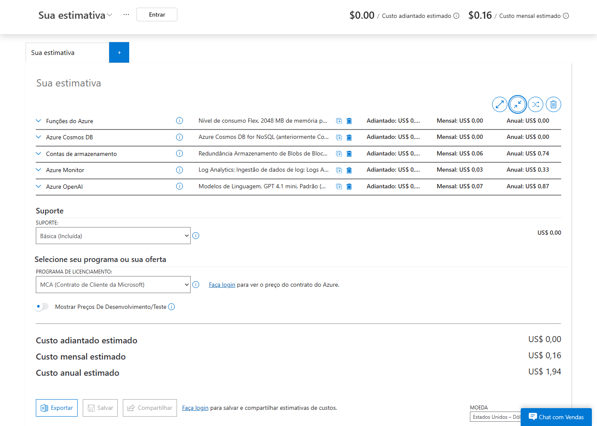
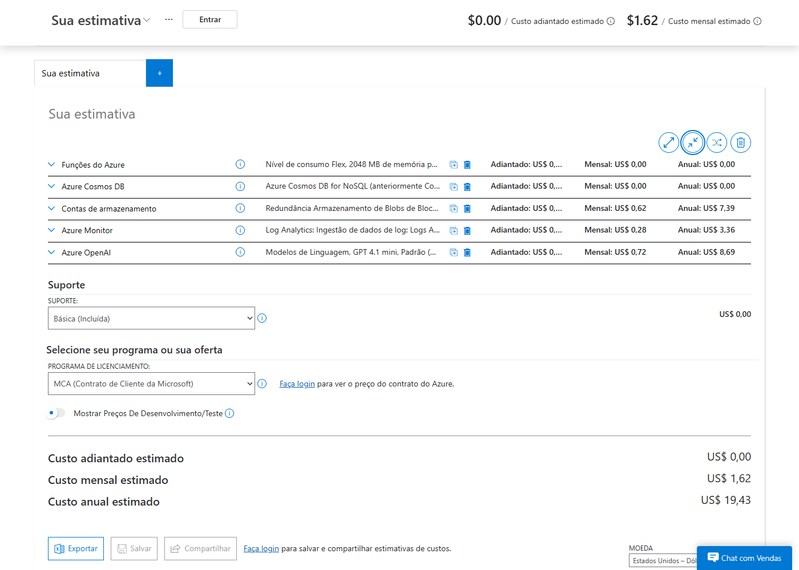

# Estimativa de custos (Calculadora de Preços do Azure)

Montada em 22/11/2026 na [Calculadora de Preços do Azure](https://azure.microsoft.com/pt-br/pricing/calculator/),
região Brazil South, pagamento conforme o uso, suporte Básico, sem login (a calculadora só gera link de
compartilhamento com conta; os prints são o registro).

- **Uso atual:** uso medido no Azure de 17/10 a 16/11/2026 (`az monitor metrics list` e tabela `Usage`
  do Log Analytics; ver [`infra/README.md`](../../infra/README.md#uso-medido-nos-últimos-30-dias-piloto)).
- **10x usuários:** todo o uso medido multiplicado por dez. O Cosmos DB continua com 1000 RU/s.

| serviço | configuração | uso atual (US$/mês) | 10x usuários (US$/mês) |
|---|---|---|---|
| Azure Functions | Flex Consumption, 2048 MB; 3.040 execuções e 3.536 GB-s (atual), 30.390 e 35.350 GB-s (10x) | 0,00 | 0,00 |
| Azure Cosmos DB | NoSQL, 1000 RU/s provisionadas, free tier; 1 GB (atual), 10 GB (10x) | 0,00 | 0,00 |
| Storage | Blob, GPv2, LRS, Hot; 1 GB e 25 mil operações (atual), 10 GB e 253 mil (10x) | 0,06 | 0,62 |
| Azure Monitor (Log Analytics) | 0,07 GB/mês (atual), 0,7 GB/mês (10x), retenção de 90 dias | 0,03 | 0,28 |
| Azure OpenAI | GPT 4.1 mini, Global; 171 mil tokens de entrada e 2,5 mil de saída (atual), 10x isso | 0,07 | 0,72 |
| **Total mensal** | | **0,16** (R$ 0,87) | **1,62** (R$ 8,71) |

## Premissas e ajustes na calculadora

- Functions: a calculadora pede execuções em lotes de 10 e segundos ativos por instância. 3.039 execuções
  viraram 304 x 10 (3.040), e 3.535 GB-s viraram 1.768 s com 2 GB (3.536 GB-s). A franquia mensal da
  assinatura (250 mil execuções e 100 mil GB-s) zera o custo nos dois cenários.
- Cosmos DB: free tier ligado (1000 RU/s e 25 GB grátis por assinatura). Camada de serviço deixada no padrão
  da calculadora; não muda o valor, que fica dentro do free tier.
- Storage: 90% das operações como leitura e 10% como escrita.
- Log Analytics: a calculadora pede GB por dia (0,0023 e 0,0233). A franquia de 5 GB/mês por assinatura
  não é aplicada pela calculadora; com ela, o item fica em zero nos dois cenários.
- Azure OpenAI: sem cache de tokens de entrada.
- Valores em reais: mesma estimativa com a moeda trocada na calculadora (`*-brl.png`).

## Arquivos

| arquivo | conteúdo |
|---|---|
| `cenario-atual-resumo.png`, `cenario-10x-resumo.png` | resumo com os cinco serviços e o total mensal |
| `cenario-*-detalhe-1.png` a `-5.png` | configuração de cada serviço, na ordem da estimativa |
| `cenario-*-brl.png` | a mesma estimativa em reais |

Uma operação real (10 caminhões ligados 24 h, sem franquias de outra assinatura) está estimada em
[`infra/README.md`](../../infra/README.md#uma-transportadora-com-10-caminhões).
