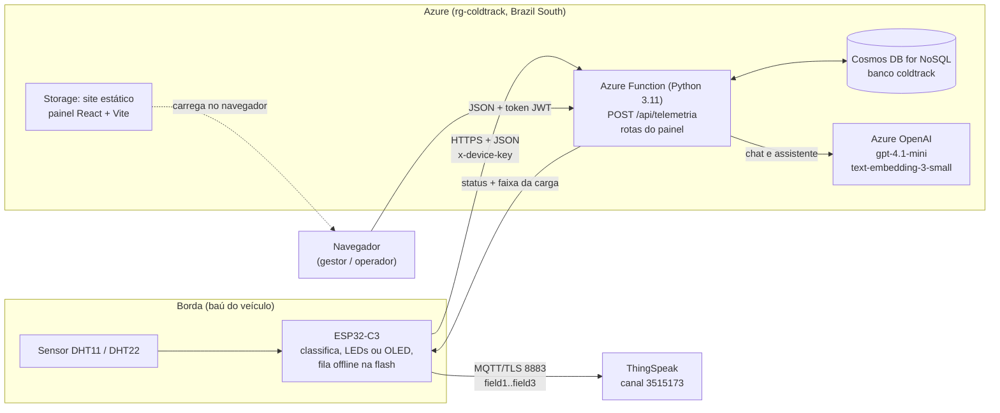
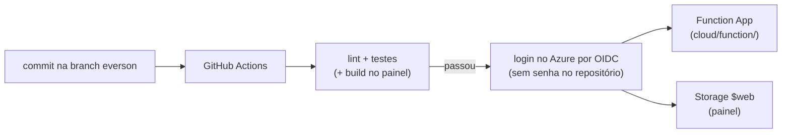

# Mapeamento de funcionalidades — ColdTrack

Mapa do que a plataforma faz hoje, camada por camada, com o arquivo onde cada
funcionalidade está implementada. Os detalhes de cada parte ficam nos documentos de
referência: [`stack-tecnica.md`](stack-tecnica.md) (arquitetura), [`api.md`](api.md) (rotas),
[`seguranca.md`](seguranca.md) (segurança) e [`implantacao.md`](implantacao.md) (implantação).
O painel web está no repositório [Front-End-pi](https://github.com/mbalbuquerque/Front-End-pi).

Caminhos de arquivo começando por `firmware/`, `cloud/`, `infra/` e `analise/` são deste
repositório; caminhos começando por `src/` e `coldtrack-qa/` são do repositório do painel.

## 1. Visão geral

O ColdTrack monitora a temperatura e a umidade dentro do baú refrigerado de caminhões que
levam frutas (manga e uva) do Vale do São Francisco aos portos. Um nó sensor com ESP32-C3 lê
o ambiente a cada 20 segundos, classifica a leitura pela faixa da carga, sinaliza na própria
placa e envia a telemetria para uma API no Azure. Um painel web mostra a situação de cada
veículo, os alertas, as viagens e os relatórios de cada empresa cliente.

| | endereço |
|---|---|
| Painel publicado | <https://stcoldtrackweb7319.z15.web.core.windows.net> |
| API (base) | `https://func-coldtrack-7319.azurewebsites.net/api` |
| Canal ThingSpeak (MQTT da placa) | <https://thingspeak.mathworks.com/channels/3515173> |
| Simulação no Wokwi | <https://wokwi.com/projects/475352296477619201> |

A API é a única fonte de dados do painel. O ThingSpeak recebe uma cópia das leituras por
MQTT, para acompanhamento público e para a plataforma de monitoramento da turma; ele não faz
parte do caminho dos dados do painel.

## 2. Dispositivo (firmware)

Firmware em C++ (Arduino) para ESP32-C3: `firmware/coldtrack/coldtrack.ino`. Circuito da
simulação em `firmware/wokwi/`.

| funcionalidade | o que faz | onde |
|---|---|---|
| Leitura DHT11 / DHT22 | Lê temperatura e umidade no GPIO 4 com um leitor próprio, que mede os pulsos com limite de tempo, não desliga as interrupções e só aceita o dado com checksum correto. O tipo do sensor (DHT11 na placa, DHT22 no simulador) é escolhido por `DHT_TYPE`. | `coldtrack.ino`: `lerDhtUmaVez`, `decodificarDht`, `lerSensor` |
| Validação da leitura (fail-fast) | Leitura inválida (`NaN`) não é enviada: a placa pisca o LED vermelho (ou mostra "ERRO SENSOR" na tela) e espera o próximo ciclo. | `coldtrack.ino`: `loop` |
| Classificação por faixa | Classifica cada leitura em NORMAL, ATENCAO ou CRITICO com a mesma regra da nuvem (faixa `min`–`max` e `margem`). A faixa vem da API em cada resposta e fica salva na flash, valendo mesmo sem sinal; sem faixa recebida, usa o perfil demonstrativo (normal até 15 °C, atenção até 20 °C). | `coldtrack.ino`: `carregarFaixa`, `atualizarFaixa`, `loop` |
| LEDs de status | Verde (normal), amarelo (atenção) e vermelho (crítico) nos GPIOs 5, 6 e 7. Amarelo piscando indica que a placa aguarda configuração. | `coldtrack.ino`: `statusNormal`, `statusAtencao`, `statusCritico` |
| Tela OLED | Na placa com OLED 0,42" embutido (SSD1306 72x40, I2C nos GPIOs 5 e 6), a tela substitui os LEDs: temperatura, umidade e status ("INICIANDO", "CONFIGURAR", "ERRO SENSOR"). Ativada por `TELA_OLED`. | `coldtrack.ino`: `mostrarNaTela` |
| Envio HTTPS ao Azure | A cada 20 s envia `{deviceId, temperatura, umidade, rssi, medidoEm}` em JSON para `POST /api/telemetria`, com a chave própria do sensor no cabeçalho `x-device-key` e verificação do certificado do servidor (raiz DigiCert Global Root G2). | `coldtrack.ino`: `montarPayload`, `postarAzure`; `azure_ca.h` |
| Relógio (NTP) | Sincroniza o horário pela internet; cada leitura leva o horário real da medição (`medidoEm`). | `coldtrack.ino`: `sincronizarRelogio`, `relogioOk` |
| Fila offline e reenvio | Sem conexão, ou com falha temporária da API, a leitura vai para um arquivo na flash (LittleFS, até 500 leituras, cerca de 2 h 45 min). Quando a rede volta, a fila é reenviada da mais antiga para a mais nova (até 10 por ciclo), com o horário original. Leituras feitas antes do relógio sincronizar são guardadas com o tempo relativo e convertidas depois. | `coldtrack.ino`: `guardarOffline`, `enfileirar`, `reenviarFila`, `reescreverFilaMs` |
| MQTT ThingSpeak | Opcional (ligado quando as credenciais MQTT estão no `secrets.h`). Mantém conexão TLS com `mqtt3.thingspeak.com:8883` e publica a cada ciclo `field1` (temperatura °C), `field2` (umidade %) e `field3` (RSSI dBm), QoS 0, com reconexão em espera crescente de 5 a 60 s. A fila offline vale só para o HTTPS. | `coldtrack.ino`: `garantirMqtt`, `publicarMqtt` |
| Medição HTTPS x MQTT | Cada envio imprime na serial uma linha `MEDIDA;<tipo>;<ms>;<bytes enviados>;<bytes recebidos>`, usada para comparar tempo e tráfego dos dois protocolos. | `coldtrack.ino`: `registrarMedida` |
| Wi-Fi | Conecta em rede de 2.4 GHz (roteador ou hotspot do celular), reconecta quando cai e informa o RSSI em cada leitura. Na placa com OLED a potência de transmissão é reduzida para 8,5 dBm, necessária para o handshake com o roteador. | `coldtrack.ino`: `conectarWiFi`, `ajustarRadio`, `aoCairWiFi` |
| Configuração pelo cabo USB | Protocolo de linha na serial (`CT<` comando JSON, `CT>` resposta): `info` devolve ID, chip, rede e versão; `config` grava Wi-Fi, ID e chave; `wifi` troca só a rede. A placa testa a rede por até 15 s antes de gravar e, se falhar, volta à anterior sem gravar nada. Os dados ficam na flash (`Preferences`); senha e chave nunca voltam pela serial. Sem configuração salva, usa o `secrets.h` (simulador). | `coldtrack.ino`: `lerSerial`, `tratarComando`, `testarWiFi`, `carregarConfig` |
| Identidade do sensor | ID sugerido a partir do chip (`coldtrack-` + final do MAC); chave gerada pela API e gravada pelo painel. | `coldtrack.ino`: `idDoChip`, `temIdentidade` |
| Autoteste do leitor DHT | Compilado com `TESTE_DHT`, confere a conversão de bytes do DHT11 e do DHT22 com casos de resposta conhecida. | `coldtrack.ino`: `autotesteDht` |

## 3. Nuvem e API

API em Python 3.11 numa Azure Function (`cloud/function/`). Referência completa em
[`api.md`](api.md).

### 3.1 Rotas

| método | rota | quem acessa | o que faz |
|---|---|---|---|
| `POST` | `/telemetria` | sensor (chave `x-device-key`) | Valida a leitura, classifica pela faixa da carga do veículo, grava e devolve `status` e `faixa`. Reenvio idêntico responde `200` (duplicada); a leitura nunca é sobrescrita. |
| `GET` | `/perfis` | aberto | Perfis de carga e faixas (demonstrativo, manga, uva). |
| `POST` | `/empresas` | aberto | Cria a empresa e o primeiro usuário, como gestor, já logado. |
| `POST` | `/login` | aberto | Troca e-mail e senha por um token JWT de 8 h. |
| `GET` | `/eu` | operador, gestor | Dados do usuário logado e da empresa. |
| `POST` | `/senha` | operador, gestor | Troca a própria senha (exige a atual); derruba as outras sessões. |
| `POST` | `/sair` | operador, gestor | Encerra todas as sessões do usuário. |
| `POST` | `/chat` | aberto | Chat público do site sobre o projeto (Azure OpenAI com busca na documentação). |
| `POST` | `/assistente` | operador, gestor | Assistente do painel: uso das telas e dados da própria empresa, somente leitura. |
| `GET` | `/leituras` | operador, gestor | Leituras de um sensor da empresa, com filtros `limite`, `horas` e `status`. |
| `GET` | `/dispositivos` | operador, gestor | Sensores da empresa. |
| `POST` | `/dispositivos` | gestor | Registra sensor e devolve a chave uma única vez. |
| `PUT` | `/dispositivos/{id}` | gestor | Gera chave nova; a anterior para de valer. |
| `DELETE` | `/dispositivos/{id}` | gestor | Remove o sensor (recusado se um veículo o usa). |
| `GET` | `/veiculos` | operador, gestor | Frota da empresa. |
| `POST`, `PUT`, `DELETE` | `/veiculos/{id}` | gestor | Cadastra, altera e remove veículo (código, tipo, sensor, perfil de carga). |
| `GET` | `/viagens` | operador, gestor | Viagens da empresa. |
| `POST`, `PUT`, `DELETE` | `/viagens/{id}` | gestor | Registra, altera (inclusive encerra) e remove viagem. |
| `GET`, `POST` | `/usuarios` | gestor | Lista e cria usuários da empresa. |
| `DELETE` | `/usuarios/{email}` | gestor | Remove usuário (não o próprio). |
| `PUT` | `/usuarios/{email}` | gestor | Redefine a senha de outro usuário e tira a conta da espera do login. |

Rotas em `cloud/function/function_app.py`; validação da telemetria em `contrato.py`; dos
cadastros em `cadastros.py`; senha, token e chave em `seguranca.py`; limites de uso em
`limites.py`; chat em `chat.py`; assistente em `assistente.py`.

### 3.2 Modelo de dados

Banco `coldtrack` no Cosmos DB for NoSQL, sete containers:

| container | chave de partição | o que guarda |
|---|---|---|
| `empresas` | `/id` | Transportadoras cadastradas. |
| `usuarios` | `/id` (e-mail) | Pessoas com acesso ao painel: nome, perfil, empresa, hash da senha, versão da sessão, falhas de login. |
| `dispositivos` | `/id` | Sensores registrados, com o SHA-256 da chave (nunca a chave). |
| `veiculos` | `/id` (`<empresa>~<código>`) | Frota, sensor instalado e perfil de carga de cada veículo. |
| `viagens` | `/id` (`<empresa>~<código>`) | Origem, destino, carga, início e fim de cada trajeto. |
| `leituras` | `/deviceId` | Uma leitura por documento: temperatura, umidade, RSSI, perfil, status, horário da medição e do recebimento. |
| `limites` | `/id` | Contadores dos limites de uso (login, chat, assistente), apagados sozinhos por TTL. |

### 3.3 Regras de negócio

- **Faixas por perfil de carga.** Cada veículo tem um perfil. Dentro de `[min, max]` a
  leitura é NORMAL; até `margem` graus fora, ATENCAO; além disso, CRITICO. Frio demais também
  conta. A regra é a mesma no firmware, na API e no painel, e a API é a fonte
  (`cloud/function/contrato.py`, `GET /perfis`).

  | perfil | normal | atenção | crítico |
  |---|---|---|---|
  | Demonstrativo (sensor sem veículo) | até 15 °C | até 20 °C | acima de 20 °C |
  | Manga | 10 a 13 °C | 7 a 10 °C ou 13 a 16 °C | abaixo de 7 °C ou acima de 16 °C |
  | Uva de mesa | -1 a 0 °C | -3 a -1 °C ou 0 a 2 °C | abaixo de -3 °C ou acima de 2 °C |

- **Multiempresa.** O token leva a empresa e toda consulta filtra por ela. Veículos e viagens
  são gravados como `<empresa>~<código>`, então duas empresas podem usar o mesmo código. Item
  de outra empresa responde igual a item inexistente (`404`).
- **Perfis de usuário.** `operador` consulta; `gestor` consulta e cadastra. A API confere o
  perfil atual do usuário no banco a cada chamada.
- **Validação da telemetria.** Temperatura de -40 a 80 °C, umidade de 0 a 100 %, RSSI de
  -120 a 0, horário da medição até 5 min no futuro e até 7 dias no passado; campo não previsto
  é erro.
- **Leitura idempotente.** O id da leitura é `<deviceId>~<medidoEm>`: o reenvio da fila
  offline não duplica dados.

## 4. Painel web

Aplicação React 18 + Vite, publicada como site estático no Azure Storage e instalável como
PWA. Rotas em `src/App.jsx` e `src/rotas.js`; uma pasta por tela em `src/pages/`. Guia do
usuário tela por tela: [`docs/guia-de-uso.md`](https://github.com/mbalbuquerque/Front-End-pi/blob/main/docs/guia-de-uso.md).

### 4.1 Telas com login

| tela | o que o usuário faz | gestor | operador | onde |
|---|---|---|---|---|
| Dashboard | Vê o veículo escolhido: temperatura, umidade, sinal Wi-Fi e status da carga; gráfico dos últimos 30 min com a faixa da carga; última telemetria; calor previsto nas próximas 24 h na rota Petrolina–Suape (Open-Meteo) com a janela mais fresca para carregar, e histórico do mês (INMET). Aceita `?veiculo=<código>`. | consulta | consulta | `src/pages/Dashboard/` |
| Veículos | Cartão por veículo com situação (NORMAL, ATENÇÃO, CRÍTICO, SEM DADOS, SEM SINAL), última comunicação, perfil e sensor; etiqueta QR para o baú, que abre o Dashboard daquele veículo (exige login). | cadastra e remove | consulta | `src/pages/Veiculos/` |
| Sensores | Lista os sensores com situação (ONLINE, SEM SINAL HÁ..., NUNCA ENVIOU), sinal e última temperatura, atualizada a cada 20 s. Conecta o sensor pelo cabo USB (Web Serial, Chrome/Edge): reconhece a placa, registra na empresa e grava Wi-Fi, ID e chave. Também registra sem cabo (Wokwi), gera chave nova e remove. | todas as ações | consulta | `src/pages/Sensores/` (`serial.js`, `sensores.js`) |
| Viagens | Viagens em andamento e concluídas: origem, destino, carga, duração, menor e maior temperatura, tempo fora da faixa e gráfico do trajeto. | registra, encerra e remove | consulta | `src/pages/Viagens/` |
| Alertas | Leituras fora da faixa agrupadas em ocorrências (24 h ou 7 dias): quantidade, críticas, pico, última ocorrência e tabela com nível, início, duração, pico e leituras. | consulta | consulta | `src/pages/Alertas/` |
| Relatórios | Resumo por período (24 h ou 7 dias, até 500 leituras): média, mínima, máxima, percentual fora da faixa, críticas, gráfico, tabela e exportação CSV. | consulta | consulta | `src/pages/Relatorios/` (`csv.js`) |
| Configurações | Minha conta e troca de senha; tabela de faixas por perfil; dados de sensores e da fonte de dados. Para o gestor: lista, criação e remoção de usuários e redefinição de senha. | tudo | conta e consultas | `src/pages/Configuracoes/` |

Todas as telas logadas compartilham o menu lateral, o indicador de conexão com o Azure, a
atualização a cada 20 s e o botão do assistente do painel (`src/components/PainelLayout.jsx`).
Rota logada sem sessão vai para `/login` (`src/components/RequireAuth.jsx`). O painel só
esconde o que o perfil não pode usar; quem bloqueia de fato é a API.

### 4.2 Telas públicas

| tela | o que faz | onde |
|---|---|---|
| Página inicial | Apresentação do produto (carrossel, projeto, diferencial, equipe, contato) e chat público. | `src/pages/Home/`, `src/components/ChatWidget/` |
| Login | Entrada com e-mail e senha. | `src/pages/Login/` |
| Cadastro de empresa | Transportadora nova cria a conta e entra como gestor. | `src/pages/Cadastro/` |
| Monitoramento | Demonstração que lê o canal público do ThingSpeak configurado em `thingspeak.js`, separada dos dados da API. | `src/pages/Monitoramento/` |
| Usuários, Auditoria, Cadastro de usuário, Gestão logística | Telas demonstrativas com dados de exemplo, sem persistência. | `src/pages/Usuarios/`, `Auditoria/`, `CadastroUsuario/`, `Logistica/` |

URLs antigas (`dashboard.html?veiculo=X` e as demais) continuam funcionando e redirecionam
para as rotas novas, para que etiquetas QR já impressas sigam válidas (`src/rotas.js`).

## 5. Inteligência artificial

Os dois recursos usam o Azure OpenAI (`gpt-4.1-mini` para a resposta,
`text-embedding-3-small` para a busca), acessado pela identidade gerenciada da Function.

| | chat público | assistente do painel |
|---|---|---|
| Onde aparece | Página inicial, botão flutuante | Todas as telas logadas, botão Assistente |
| Rota | `POST /chat` (aberta) | `POST /assistente` (token de operador ou gestor) |
| Responde sobre | O projeto ColdTrack | Uso das telas e dados da própria empresa |
| Contexto | Os 4 trechos da documentação mais parecidos com a pergunta (RAG por embeddings, base `cloud/function/base_chat.json`) | Retrato somente leitura da empresa do token (veículos, sensores, última leitura e resumo de 24 h, viagens; usuários só para gestor) mais os trechos da base |
| Fora do assunto | Diz que não sabe e indica o contato pelo WhatsApp | Recusa curta |
| Plano B | Se a rota falhar, o site responde pelo FAQ local (`src/components/ChatWidget/respostas.js`) | Mensagem de indisponibilidade; não há FAQ, porque depende dos dados |
| Limites | 10 perguntas por minuto por IP; 2000 por dia no site | 15 por minuto por usuário; 300 por dia por empresa |
| Código | `cloud/function/chat.py`, `src/lib/chat.js` | `cloud/function/assistente.py`, `src/lib/assistente.js`, `src/components/AssistentePainel/` |

Comum aos dois: pergunta de até 500 caracteres, histórico das últimas 6 mensagens, tempo
limite de 20 s, links que não sejam do site trocados por `[link removido]`, nada da conversa
gravado no servidor. O assistente não executa ações: explica o caminho nas telas. Os textos
digitados por usuários vão ao modelo marcados como dado não confiável.

## 6. Segurança

Resumo de [`seguranca.md`](seguranca.md):

- **Sensor.** Chave própria por sensor (32 bytes aleatórios, mostrada uma vez, banco guarda
  só o SHA-256), válida só para o próprio `deviceId`; HTTPS com certificado verificado.
- **Pessoas.** Senha com scrypt e sal por usuário; token JWT HS256 de 8 h; a cada chamada a
  API relê o usuário no banco, então sair, trocar senha ou remover o usuário derruba o token
  na hora.
- **Login.** Mesma resposta para e-mail inexistente, senha errada e conta em espera; espera
  crescente de 1 a 15 min a partir da 5ª senha errada; 20 falhas por IP a cada 15 min.
- **Separação entre empresas.** Toda consulta filtra pela empresa do token; item de outra
  empresa responde como inexistente.
- **Entrada e saída.** Consultas ao Cosmos parametrizadas; React escapa o texto; CSV escapa
  células para não virar fórmula; CSP no painel; logs sem senha, token ou texto das perguntas,
  e-mails mascarados.
- **Nuvem.** Só HTTPS, TLS 1.2 mínimo, CORS só para o painel, publicação por OIDC sem senha
  no repositório, Azure OpenAI sem chave de API.
- **Limitações aceitas no protótipo.** Segredos em app settings (sem Key Vault), token no
  `localStorage`, cadastro sem confirmação de e-mail; lista completa em `seguranca.md`.

## 7. Testes e qualidade

| suíte | o que cobre | resultado |
|---|---|---|
| API (`unittest`, `cloud/function/test_*.py`) | Contrato da telemetria, horário, filtros, faixas por perfil, senha, token, bloqueio, chave de sensor, cadastros, separação entre empresas, limites de uso, chat e assistente | 155 testes, todos passando no GitHub Actions |
| Lint da API | `ruff check` | sem avisos |
| Firmware | Compilação para ESP32-C3 nas variantes DHT22 (simulador) e DHT11 (placa) | no GitHub Actions |
| Simulação Wokwi | Firmware real enviando ao Azure, queda de conexão com fila, excursão térmica, faixa da manga e LED de frio demais | executada com `wokwi-cli` |
| Painel: unitários (Vitest) | Regras sem tela: leituras, faixas, sessão, API, CSV, sensores, serial, viagens, etiqueta, chat e assistente | 158 passaram, 0 falharam |
| Painel: e2e simulado (Playwright) | Todas as telas em desktop e celular com a API simulada, gestor e operador, chat, assistente, CSP, URLs antigas | 206 passaram, 0 falharam, 18 pulados de propósito |
| Painel: e2e real (Playwright) | Site publicado e API de produção: login, sessão, cadastros, operador, telas em 1280 e 390 px, CSV, chat | 57 passaram, 0 falharam |

Resultados do painel em
[`relatorio-de-testes.md`](https://github.com/mbalbuquerque/Front-End-pi/blob/main/docs/relatorio-de-testes.md)
(execução de 08/11/2026).

**CI/CD.** No repositório do back, `.github/workflows/testes.yml` roda lint, testes da API e
compilação do firmware a cada push e pull request, e `publicar-api.yml` publica a API. No
repositório do painel, `testes.yml` roda lint, unitários, build e e2e, e `publicar-site.yml`
publica o site.

## 8. Infraestrutura Azure e publicação

Assinatura Azure for Students, grupo `rg-coldtrack`, região Brazil South. Descrição versionada
em `infra/main.bicep` e `infra/README.md`.

| recurso | nome | função |
|---|---|---|
| Function App (Flex Consumption, Python 3.11) | `func-coldtrack-7319` | API |
| Cosmos DB for NoSQL (camada gratuita) | `cosmos-coldtrack-7319` | Banco de dados |
| Azure OpenAI | `aoai-coldtrack-7319` | Chat, assistente e embeddings |
| Storage (site estático) | `stcoldtrackweb7319` | Painel web |
| Storage | `stcoldtrack7319` | Armazenamento interno da Function |
| Application Insights | `func-coldtrack-7319` | Logs e erros da API |

**Fluxo de publicação.**

A identidade de publicação só tem permissão no grupo `rg-coldtrack` e só é aceita para a
branch `everson` dos dois repositórios. O firmware é compilado e gravado pelo cabo USB.

## 9. Monitoramento ThingSpeak e plataforma da turma

- A placa publica por MQTT no canal público **3515173** ("ColdTrack MQTT") do ThingSpeak:
  `field1` temperatura (°C), `field2` umidade (%), `field3` RSSI (dBm), a cada 20 s.
  Canal: <https://thingspeak.mathworks.com/channels/3515173>.
- O mesmo canal está registrado na plataforma de monitoramento da turma (iotdashthings), que
  acompanha os dispositivos dos projetos a partir do ThingSpeak.
- O envio MQTT é independente do HTTPS: se o MQTT falhar, a leitura segue para o Azure; se o
  Azure falhar, a leitura vai para a fila offline.
- A tela Monitoramento do painel é uma demonstração separada que lê um canal público do
  ThingSpeak; os dados oficiais do painel vêm sempre da API.

## 10. Análise climática da rota

Scripts em `analise/` baixam e tratam os dados horários das estações automáticas do INMET ao
longo da rota Petrolina–Suape (2020 a 2025) e geram um modelo preliminar de risco térmico
(`analise/relatorio.md`). O resultado alimenta o histórico do mês mostrado no Dashboard.
