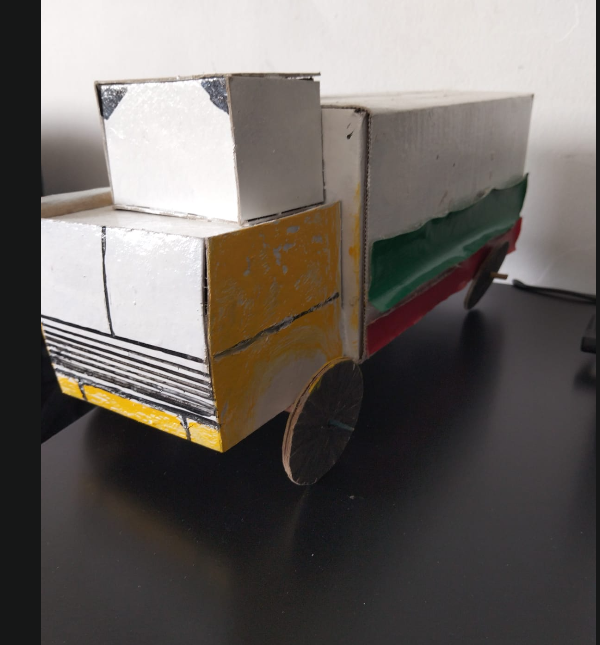
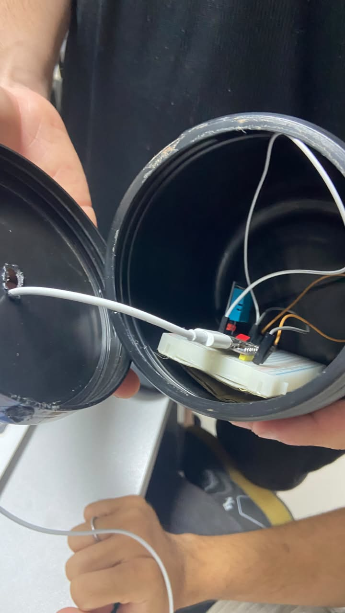
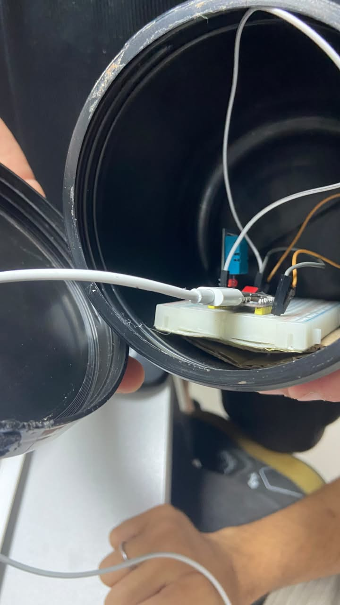
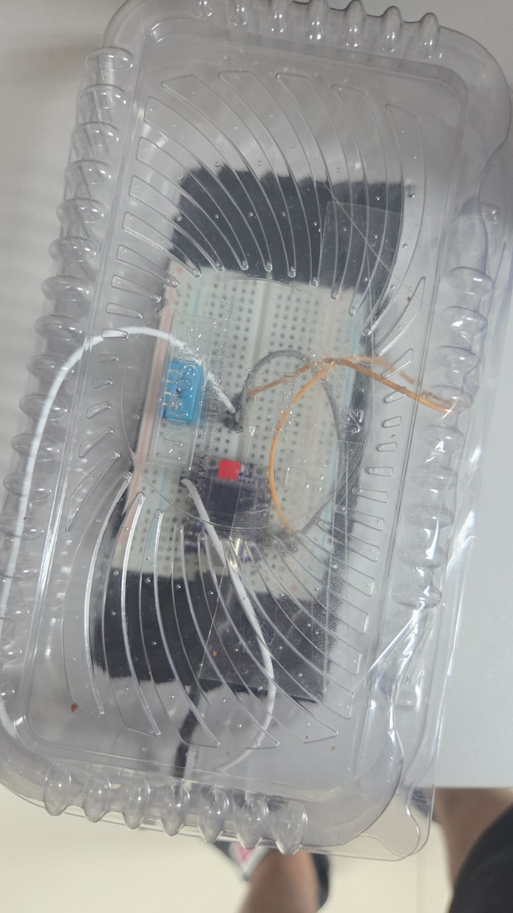

# Caixa do artefato

**Situação: montagem pronta (23/11).** A placa e o DHT ficam no pote preto, e a protoboard está
presa dentro da maquete do caminhão (informado pela equipe em 23/11). A entrega final exige o artefato acomodado em
caixa adequada, elaborada pela equipe ou adaptada de material reaproveitado.

## Fotos (23/11/2026)

**Maquete do caminhão (protótipo do cenário de transporte).** Maquete de papelão, branca e amarela,
com a carroceria de faixas verde e vermelha, vista de frente em ângulo.

**Caixa do dispositivo (pote preto com tampa, alimentação por cabo).** Pote plástico preto com tampa,
sobre uma mesa preta, fechado; um cabo aparece ao lado, na lateral direita da foto.

## Montagem interna (23/11/2026, 22h)

**Pote preto aberto, tampa à esquerda.** A protoboard com a ESP32-C3 e o DHT (azul) fica no fundo
do pote, sobre um papelão; o cabo USB entra por um furo na tampa e vai direto à placa.
Jumpers ligam o DHT à placa.

**Detalhe:** o DHT fica na mesma protoboard da placa, a poucos centímetros dela.

**Versão anterior (23/11, 19h):** a mesma protoboard com placa e DHT dentro de um pote plástico
transparente, fechado, com o cabo saindo pela lateral.

O que as fotos de 23/11 à tarde **não** mostravam (agora resolvido em parte pelas fotos da montagem): a placa dentro do pote, o DHT, a tela OLED, as aberturas para o
sensor e para o cabo, a fixação e a etiqueta com o `deviceId`. Não há calibração registrada.

## Requisitos

- Abrigar a placa ESP32-C3, o DHT e o cabo USB, sem esforço mecânico nos fios.
- Abertura para o sensor medir o ar do ambiente (o DHT não pode ficar colado na placa, que
  esquenta e falseia a temperatura).
- Abertura para a tela OLED (leitura sem abrir a caixa) e passagem do cabo USB.
- Material isolante (plástico ou acrílico); sem metal encostando nos pinos.
- Fixação da placa (parafusos, espuma ou abraçadeira) e do sensor.
- Etiqueta externa com o `deviceId` do sensor (nunca a chave).

## Checklist de montagem

Só está marcado o que as fotos comprovam.

- [x] Caixa escolhida: pote plástico preto com tampa (foto `caixa-dispositivo.png`)
- [x] Foto da montagem com a placa e o sensor na caixa (`montagem-pote-tampa-aberta.jpg`, `montagem-pote-detalhe.jpg`)
- [x] Cabo USB passando por um furo na tampa
- [x] Placa fixa: protoboard presa dentro da maquete do caminhão (informado pela equipe em 23/11/2026)
- [x] Maquete do caminhão pronta (`maquete-caminhao.png`)
- [ ] DHT afastado da placa e ventilado (hoje fica na mesma protoboard, a poucos centímetros, dentro do pote fechado)
- [ ] Fios soldados ou com conector firme (hoje são jumpers na protoboard)
- [ ] Tela visível pela janela
- [ ] Tampa fecha sem pressionar o sensor
- [ ] Teste com a caixa fechada: leitura chega ao painel e a tela mostra o status

## Observação de medição

Com o pote fechado, as leituras de 23/11 à noite ficaram entre 33 e 35 °C: o calor da placa fica
preso perto do sensor. Para medir o ar do ambiente com mais fidelidade, o próximo passo é um furo
de ventilação na lateral do pote, com o DHT afastado da placa.

## Registro

| Item | Valor |
|---|---|
| Material da caixa | Pote plástico preto com tampa (pelo que se vê na foto) |
| Dimensões | |
| Responsável e data | Fotos de 23/11/2026 |
| Foto | [`fotos/caixa-dispositivo.png`](fotos/caixa-dispositivo.png), [`fotos/maquete-caminhao.png`](fotos/maquete-caminhao.png), [`fotos/montagem-pote-tampa-aberta.jpg`](fotos/montagem-pote-tampa-aberta.jpg), [`fotos/montagem-pote-detalhe.jpg`](fotos/montagem-pote-detalhe.jpg) e [`fotos/montagem-pote-transparente.jpg`](fotos/montagem-pote-transparente.jpg) |
