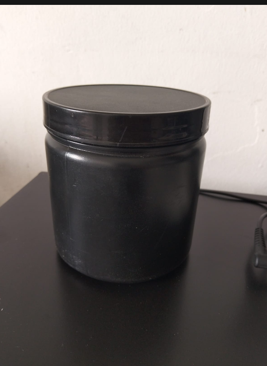

# Caixa do artefato

**Situação: caixa escolhida e fotografada fechada; montagem interna ainda sem foto.** A entrega
final exige o artefato acomodado em caixa adequada, elaborada pela equipe ou adaptada de material
reaproveitado. As fotos de 23/11 mostram a maquete e o pote, mas não mostram a placa, o sensor nem
a tela.

## Fotos (23/11/2026)

**Maquete do caminhão (protótipo do cenário de transporte).** Maquete de papelão, branca e amarela,
com a carroceria de faixas verde e vermelha, vista de frente em ângulo.

**Caixa do dispositivo (pote preto com tampa, alimentação por cabo).** Pote plástico preto com tampa,
sobre uma mesa preta, fechado; um cabo aparece ao lado, na lateral direita da foto.

O que as fotos **não** mostram: a placa dentro do pote, o DHT, a tela OLED, as aberturas para o
sensor e para o cabo, a fixação e a etiqueta com o `deviceId`. Não há calibração registrada.

## Requisitos

- Abrigar a placa ESP32-C3, o DHT e o cabo USB, sem esforço mecânico nos fios.
- Abertura para o sensor medir o ar do ambiente (o DHT não pode ficar colado na placa, que
  esquenta e falseia a temperatura).
- Abertura para a tela OLED (leitura sem abrir a caixa) e passagem do cabo USB.
- Material isolante (plástico ou acrílico); sem metal encostando nos pinos.
- Fixação da placa (parafusos, espuma ou abraçadeira) e do sensor.
- Etiqueta externa com o `deviceId` do sensor (nunca a chave).

## Checklist de montagem

Só está marcado o que as fotos comprovam.

- [x] Caixa escolhida: pote plástico preto com tampa, fechado, com um cabo ao lado (foto `caixa-dispositivo.png`)
- [ ] Placa fixa e sem folga
- [ ] DHT afastado da placa e ventilado
- [ ] Fios soldados ou com conector firme (GPIO 4, 3V3, GND)
- [ ] Tela visível pela janela
- [ ] Cabo USB com alívio de tração
- [ ] Tampa fecha sem pressionar o sensor
- [ ] Foto da montagem final com a placa e o sensor na caixa, em `docs/hardware/fotos/`
- [ ] Teste com a caixa fechada: leitura chega ao painel e a tela mostra o status

## Registro

| Item | Valor |
|---|---|
| Material da caixa | Pote plástico preto com tampa (pelo que se vê na foto) |
| Dimensões | |
| Responsável e data | Fotos de 23/11/2026 |
| Foto | [`fotos/caixa-dispositivo.png`](fotos/caixa-dispositivo.png) e [`fotos/maquete-caminhao.png`](fotos/maquete-caminhao.png) |
